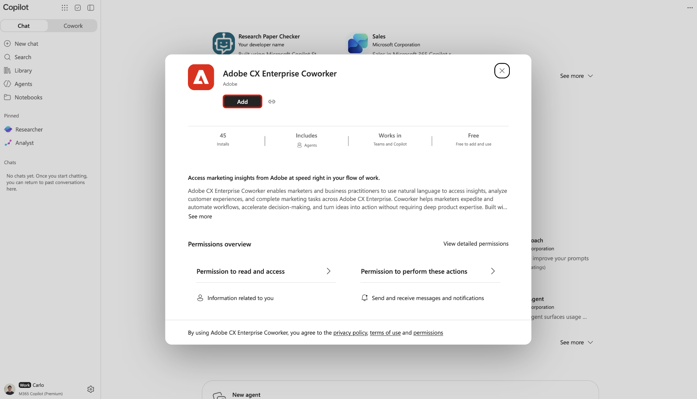

# Adobe CX Enterprise Coworker para plataformas de IA

Use o Adobe CX Enterprise Coworker para plataformas de IA para obter insights de marketing nas ferramentas de IA que você já usa. Faça perguntas em linguagem natural sem alternar entre as ferramentas. Encontre o produto listado como Adobe CX Enterprise Coworker em cada plataforma.

Encontre plataformas disponíveis e suas instruções de configuração em [Configurar Colaborador](#set-up-coworker).

Não há custo adicional para usar o Colaborador em plataformas de IA. Ele está incluído na sua licença do CX Enterprise Coworker e o uso é obtido dos mesmos créditos de IA que outros recursos do Colaborador. Para obter mais informações, consulte [Consumo de créditos de AI e trabalhos do agente do Adobe Experience Platform](https://experienceleague.adobe.com/pt-br/docs/cx-enterprise-ai/experience-cloud-ai/overview/ai-credit-consumption){target="_blank"}.

<!-- TODO: architecture diagram pending from engineering. KT page notes "to be provided on 8/28"; still outstanding as of 8/31. Insert here once received. -->

## Pré-requisitos {#prerequisites}

Antes de usar o Coworker em uma plataforma de IA, confirme se você tem o seguinte.

* O Adobe CX Enterprise Coworker foi provisionado para sua organização e seu próprio acesso a ele no Adobe.
* Adobe Experience Platform e pelo menos um dos produtos Adobe Real-Time CDP, Adobe Journey Optimizer ou Adobe Customer Journey Analytics.
* Acesso a uma plataforma de IA listada em [Configurar Colaborador](#set-up-coworker).

## Acesso aos dados e permissões {#data-access-and-permissions}

Os colegas de trabalho nas plataformas de IA refletem os mesmos dados e nível de acesso vinculados à identidade da Adobe. O que você pode consultar e ver corresponde ao que já tem direito no Experience Platform e suas soluções associadas. O colega herda essas permissões, portanto, nenhuma configuração de permissão separada é necessária para a integração da plataforma de IA. O colaborador retorna insights somente leitura e não modifica os dados do cliente. Revise quaisquer resumos e análises gerados antes de usá-los para tomar decisões comerciais.

<!-- Confirmed by PM (Siddhartha Srivastava) on 2026-09-02 for Microsoft 365 Copilot, Claude, and ChatGPT. Validate this permissions model for each additional platform before adding its setup tab. -->

## Principais casos de uso {#key-use-cases}

Use o Colaborador em plataformas de IA para acelerar fluxos de trabalho de marketing comuns sem sair das suas ferramentas diárias.

| Caso de uso | Descrição |
| --- | --- |
| Planejar e revisar campanhas | Planejar campanhas, incluindo revisões de campanhas de parceiros e previsões de público-alvo. Compare o desempenho da campanha ao longo do tempo e identifique quais pontos de contato geram conversões. |
| Monitorar jornadas e prontidão da campanha | Analise e monitore campanhas ativas, analise as jornadas dos clientes e avalie a disponibilidade da campanha. Rastreie o desempenho da jornada e as quedas para identificar oportunidades de otimização. |
| Recuperar insights operacionais | Identifique quais públicos são maiores ou mais envolvidos para que você possa priorizar onde concentrar seus esforços e acompanhar como seus segmentos crescem ou diminuem ao longo do tempo. |
| Otimizar fluxos de trabalho e conteúdo | Otimize os fluxos de trabalho e identifique as necessidades de ativos e conteúdo para campanhas CX. Gerar relatórios visuais sobre o desempenho da campanha sem criar consultas ou painéis manualmente. |
| Colabore e decida com mais rapidez | Use os prompts sugeridos para explorar públicos, campanhas e tráfego da Web. Compartilhe insights com sua equipe durante as reuniões de planejamento e responda a perguntas ad hoc em tempo real ao revisar planos ou apresentações. |

<!-- Use cases approved by PM Siddhartha Srivastava on 2026-08-31 and confirmed for Microsoft 365 Copilot, Claude, and ChatGPT on 2026-09-02. Validate applicability for each additional platform before adding its setup tab. -->

## Configurar Colaborador {#set-up-coworker}

Selecione uma plataforma disponível para obter instruções de configuração. Após a instalação, tente os [exemplos de prompts](#example-prompts).

>[!BEGINTABS]

>[!TAB Microsoft 365 Copilot]

Use [!DNL Adobe CX Enterprise Coworker for Copilot] para obter insights de marketing em [!DNL Microsoft 365 Copilot].

Antes de começar, confirme se você tem acesso a [!DNL Microsoft 365 Copilot].

**Configurar o colega para sua organização**

Um administrador deve concluir essas etapas para que os usuários finais possam acessar o Co-worker em [!DNL Microsoft 365 Copilot].

1. No [!DNL Microsoft 365 admin center], confirme se suas configurações de locatário permitem aplicativos e agentes criados por editores externos.
1. Aprove o **[!UICONTROL Adobe CX Enterprise Coworker]** no [!DNL Microsoft 365 admin center] e no [!DNL Teams admin center]. Normalmente, você pode encontrar o agente por meio do [!DNL Microsoft Commercial Marketplace] ou da lista **[!UICONTROL Aplicativos integrados]** da sua organização.
1. Implante o agente para os usuários finais. Você pode implantá-lo em usuários ou grupos específicos ou em toda a organização. O número de usuários habilitado não afeta a configuração nem o custo.

>[!NOTE]
>
>Se o [!DNL Microsoft] lançar uma atualização do Colaborador que exija novas permissões, o administrador deverá aprovar a atualização no [!DNL Agent Registry] antes que ela seja implantada para os usuários.

**Acessar o Colaborador em[!DNL Copilot]**

Depois que o administrador habilitar o Coworker, você poderá acessá-lo nas [!DNL Microsoft 365 Copilot] superfícies, incluindo [!DNL Teams], [!DNL Word], [!DNL Excel], [!DNL PowerPoint] e o bate-papo na Web.

Em [!DNL Microsoft 365 Copilot], selecione **[!UICONTROL Agentes]** e, em seguida, selecione **[!UICONTROL Mais agentes]**.

Em seguida, selecione **[!UICONTROL Adobe CX Enterprise Coworker]** no catálogo do agente.

Finalmente, selecione **[!UICONTROL Adicionar]** para adicionar o Colaborador aos seus agentes.

>[!TAB GPTchat]

Use [!DNL Adobe CX Enterprise Coworker for ChatGPT] para obter insights de marketing em [!DNL ChatGPT].

Antes de começar, confirme se você tem acesso a [!DNL ChatGPT].

**Configurar o colega para sua organização**

* Peça ao administrador do [!DNL ChatGPT] para aprovar o **[!UICONTROL Adobe CX Enterprise Coworker]** para os usuários selecionados ou para toda a organização.

**Acessar o Colaborador em[!DNL ChatGPT]**

Em [!DNL ChatGPT], selecione **[!UICONTROL Plug-ins]**.

Em seguida, localize e selecione **[!UICONTROL Adobe CX Enterprise Coworker]** no catálogo de plug-ins.

Finalmente, selecione **[!UICONTROL Instalar plug-in]** para adicionar Coworker a [!DNL ChatGPT].

>[!TAB Claude]

Use o Colaborador para obter insights de marketing em [!DNL Claude].

Antes de começar, confirme se você tem acesso a [!DNL Claude].

**Configurar o colega para sua organização**

* Peça ao administrador do [!DNL Claude] para aprovar o **[!UICONTROL Adobe CX Enterprise Coworker]** para os usuários selecionados ou para toda a organização.

**Acessar o Colaborador em[!DNL Claude]**

1. Em [!DNL Claude], selecione **[!UICONTROL Personalizar]**.

   

1. Selecione **[!UICONTROL Conectores]**, depois **[!UICONTROL Descobrir]** e use a **[!UICONTROL Pesquisa]** para encontrar o Adobe CX Enterprise Coworker.

   

1. Selecione **[!UICONTROL Adobe CX Enterprise Coworker]** e **[!UICONTROL Conectar a Claude]**.

   

1. Entre com as credenciais da Adobe para conectar o Colaborador ao [!DNL Claude].

>[!ENDTABS]

<!-- Setup steps above reflect the real customer-facing flow confirmed by PM (Siddhartha Srivastava) on 2026-09-02: an org admin approves the connector or plugin, then end users find and add it in their platform's catalog and sign in. The previous version of this file described a manual MCP-connector setup for ChatGPT (Settings > Connectors > paste server URL) -- PM clarified that flow is for internal testing only, not the customer path, so it was removed here. -->

## Exemplo de prompts {#example-prompts}

Depois de configurar o Coworker em uma plataforma compatível, tente esses prompts ou escreva o seu próprio em linguagem natural.

* Mostre seus cinco principais públicos-alvo.
* Mostrar uma métrica para o último mês.
* Mostrar seus projetos ativos do Workfront.
* Mostre jornadas com públicos-alvo de fidelidade.

## Limitações conhecidas {#known-limitations}

Os colegas de trabalho nas plataformas de IA não são compatíveis com todos os padrões de integração.

* Você não pode conectar o Coworker ao seu próprio arnês de agente usando o MCP.

## Solução de problemas de colegas de trabalho em plataformas de IA {#troubleshoot}

Tente essas etapas se tiver problemas usando o Colaborador em uma plataforma de IA.

* Se você vir um erro, saia e entre novamente com suas credenciais da Adobe. A reautenticação resolve a maioria dos problemas.
* Se não conseguir acessar o Colaborador ou dados específicos, entre em contato com o administrador do Adobe para confirmar o acesso e as permissões do produto.

<!--
Editorial maintenance, 2026-10-27:
Only approved platforms with validated setup guidance belong in the rendered tab set.
Remaining platforms to add: Gemini, Amazon Quick, IBM, and Databricks.

To add an approved platform:
* Confirm approval and obtain access to the customer flow.
* Validate prerequisites, organization approval, catalog discovery, listing name, installation, and Adobe sign-in.
* Confirm the shared licensing, permissions, use cases, prompts, limitations, and troubleshooting guidance applies.
* Add one tab before ENDTABS, following the existing order: introduction, platform prerequisites, organization setup, and user access.
* Document any platform-specific requirements or exceptions within that tab.
* Preview the tab and verify its links and image references.
Keep the introduction, metadata, and shared prerequisites free of platform lists so adding a tab does not require duplicate updates.

Gemini draft scope:
No setup steps are confirmed. Validate the complete customer flow and all shared guidance before adding the tab.
Do not infer the flow from another platform.
-->
