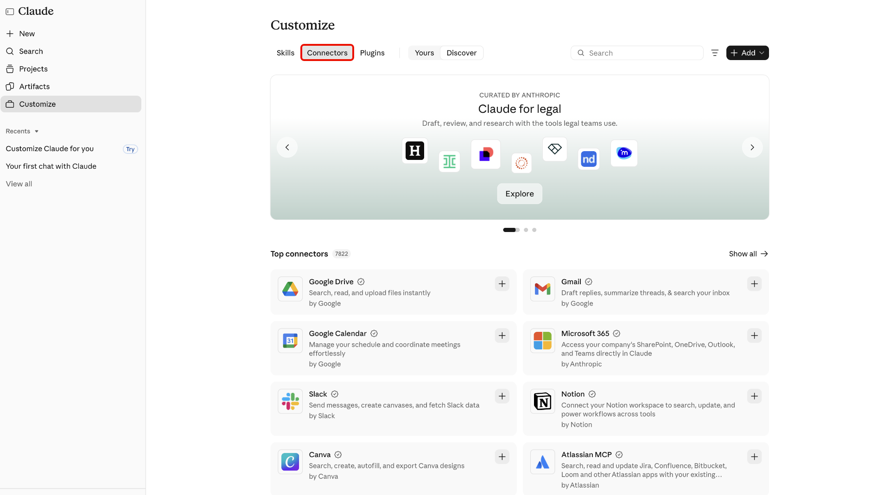
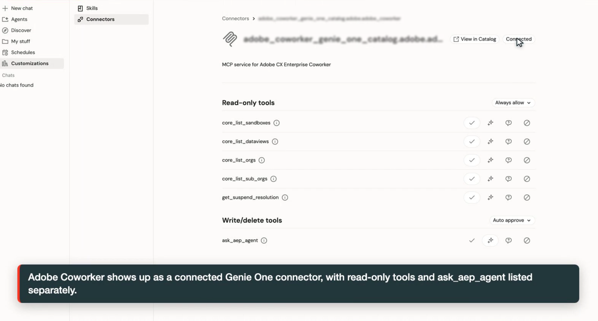

# Adobe CX Enterprise Coworker para plataformas de IA

Use o Adobe CX Enterprise Coworker para plataformas de IA para obter insights de marketing nas ferramentas de IA que você já usa. Faça perguntas em linguagem natural sem alternar entre as ferramentas. Encontre o produto listado como Adobe CX Enterprise Coworker em cada plataforma.

Encontre plataformas disponíveis e suas instruções de configuração em [Configurar Colaborador](#set-up-coworker).

Não há custo adicional para usar o Colaborador em plataformas de IA. Ele está incluído na sua licença do CX Enterprise Coworker e o uso é obtido dos mesmos créditos de IA que outros recursos do Colaborador. Para obter mais informações, consulte [Consumo de créditos de AI e trabalhos do agente do Adobe Experience Platform](https://experienceleague.adobe.com/pt-br/docs/cx-enterprise-ai/experience-cloud-ai/overview/ai-credit-consumption){target="_blank"}.

<!-- TODO: architecture diagram pending from engineering. KT page notes "to be provided on 8/28"; still outstanding as of 8/31. Insert here once received. -->

## Pré-requisitos {#prerequisites}

Antes de usar o Coworker em uma plataforma de IA, confirme se você tem o seguinte.

* O Adobe CX Enterprise Coworker foi provisionado para sua organização e seu próprio acesso a ele no Adobe.
* Adobe Experience Platform e pelo menos um dos produtos Adobe Real-Time CDP, Adobe Journey Optimizer ou Adobe Customer Journey Analytics.
* Acesso a uma plataforma de IA listada em [Configurar Colaborador](#set-up-coworker).

## Acesso aos dados e permissões {#data-access-and-permissions}

Os colegas de trabalho nas plataformas de IA refletem os mesmos dados e nível de acesso vinculados à identidade da Adobe. O que você pode consultar e ver corresponde ao que já tem direito no Experience Platform e suas soluções associadas. O colega herda essas permissões, portanto, nenhuma configuração de permissão separada é necessária para a integração da plataforma de IA. O colaborador retorna insights somente leitura e não modifica os dados do cliente. Revise quaisquer resumos e análises gerados antes de usá-los para tomar decisões comerciais.

<!-- Confirmed by PM (Siddhartha Srivastava) on 2026-09-02 for Microsoft 365 Copilot, Claude, and ChatGPT. Validate this permissions model for each additional platform before adding its setup section. -->

## Principais casos de uso {#key-use-cases}

Use o Colaborador em plataformas de IA para acelerar fluxos de trabalho de marketing comuns sem sair das suas ferramentas diárias.

| Caso de uso | Descrição |
| --- | --- |
| Planejar e revisar campanhas | Planejar campanhas, incluindo revisões de campanhas de parceiros e previsões de público-alvo. Compare o desempenho da campanha ao longo do tempo e identifique quais pontos de contato geram conversões. |
| Monitorar jornadas e prontidão da campanha | Analise e monitore campanhas ativas, analise as jornadas dos clientes e avalie a disponibilidade da campanha. Rastreie o desempenho da jornada e as quedas para identificar oportunidades de otimização. |
| Recuperar insights operacionais | Identifique quais públicos são maiores ou mais envolvidos para que você possa priorizar onde concentrar seus esforços e acompanhar como seus segmentos crescem ou diminuem ao longo do tempo. |
| Otimizar fluxos de trabalho e conteúdo | Otimize os fluxos de trabalho e identifique as necessidades de ativos e conteúdo para campanhas CX. Gerar relatórios visuais sobre o desempenho da campanha sem criar consultas ou painéis manualmente. |
| Colabore e decida com mais rapidez | Use os prompts sugeridos para explorar públicos, campanhas e tráfego da Web. Compartilhe insights com sua equipe durante as reuniões de planejamento e responda a perguntas ad hoc em tempo real ao revisar planos ou apresentações. |

<!-- Use cases approved by PM Siddhartha Srivastava on 2026-08-31 and confirmed for Microsoft 365 Copilot, Claude, and ChatGPT on 2026-09-02. Validate applicability for each additional platform before adding its setup section. -->

## Configurar Colaborador {#set-up-coworker}

Selecione uma plataforma disponível para obter instruções de configuração. Após a instalação, tente os [exemplos de prompts](#example-prompts).

* [Microsoft 365 Copilot](#microsoft-365-copilot)
* [ChatGPT](#chatgpt)
* [Claude](#claude)
* [Gemini - Empresa](#gemini-enterprise)
* [Amazon Quick](#amazon-quick)
* [IBM Watsonx Orchestrate](#ibm-watsonx-orchestrate)
* [Databricks](#databricks)

### [!DNL Microsoft 365 Copilot] {#microsoft-365-copilot}

Use [!DNL Adobe CX Enterprise Coworker for Copilot] para obter insights de marketing em [!DNL Microsoft 365 Copilot].

Antes de começar, confirme se você tem acesso a [!DNL Microsoft 365 Copilot].

#### Configurar acesso da organização {#copilot-organization-setup}

Um administrador deve concluir essas etapas para que os usuários finais possam acessar o Co-worker em [!DNL Microsoft 365 Copilot].

1. No [!DNL Microsoft 365 admin center], confirme se suas configurações de locatário permitem aplicativos e agentes criados por editores externos.
1. Aprove o **[!UICONTROL Adobe CX Enterprise Coworker]** no [!DNL Microsoft 365 admin center] e no [!DNL Teams admin center]. Normalmente, você pode encontrar o agente por meio do [!DNL Microsoft Commercial Marketplace] ou da lista **[!UICONTROL Aplicativos integrados]** da sua organização.
1. Implante o agente para os usuários finais. Você pode implantá-lo em usuários ou grupos específicos ou em toda a organização. O número de usuários habilitado não afeta a configuração nem o custo.

>[!NOTE]
>
>Se o [!DNL Microsoft] lançar uma atualização do Colaborador que exija novas permissões, o administrador deverá aprovar a atualização no [!DNL Agent Registry] antes que ela seja implantada para os usuários.

#### Acessar colega {#copilot-access}

Depois que o administrador habilitar o Coworker, você poderá acessá-lo nas [!DNL Microsoft 365 Copilot] superfícies, incluindo [!DNL Teams], [!DNL Word], [!DNL Excel], [!DNL PowerPoint] e o bate-papo na Web.

Em [!DNL Microsoft 365 Copilot], selecione **[!UICONTROL Agentes]** e, em seguida, selecione **[!UICONTROL Mais agentes]**.

Em seguida, selecione **[!UICONTROL Adobe CX Enterprise Coworker]** no catálogo do agente.

Finalmente, selecione **[!UICONTROL Adicionar]** para adicionar o Colaborador aos seus agentes.

### [!DNL ChatGPT] {#chatgpt}

Use [!DNL Adobe CX Enterprise Coworker for ChatGPT] para obter insights de marketing em [!DNL ChatGPT].

Antes de começar, confirme se você tem acesso a [!DNL ChatGPT].

#### Configurar acesso da organização {#chatgpt-organization-setup}

O administrador deve aprovar o Colaborador antes de adicioná-lo.

* Peça ao administrador do [!DNL ChatGPT] para aprovar o **[!UICONTROL Adobe CX Enterprise Coworker]** para os usuários selecionados ou para toda a organização.

#### Acessar colega {#chatgpt-access}

Em [!DNL ChatGPT], selecione **[!UICONTROL Plug-ins]**.

Em seguida, localize e selecione **[!UICONTROL Adobe CX Enterprise Coworker]** no catálogo de plug-ins.

Finalmente, selecione **[!UICONTROL Instalar plug-in]** para adicionar Coworker a [!DNL ChatGPT].

### [!DNL Claude] {#claude}

Use o Colaborador para obter insights de marketing em [!DNL Claude].

Antes de começar, confirme se você tem acesso a [!DNL Claude].

#### Configurar acesso da organização {#claude-organization-setup}

O administrador deve aprovar o Colaborador antes de adicioná-lo.

* Peça ao administrador do [!DNL Claude] para aprovar o **[!UICONTROL Adobe CX Enterprise Coworker]** para os usuários selecionados ou para toda a organização.

#### Acessar colega {#claude-access}

1. Em [!DNL Claude], selecione **[!UICONTROL Personalizar]**.

   

1. Selecione **[!UICONTROL Conectores]**, depois **[!UICONTROL Descobrir]** e use a **[!UICONTROL Pesquisa]** para encontrar o Adobe CX Enterprise Coworker.

   

1. Selecione **[!UICONTROL Adobe CX Enterprise Coworker]** e **[!UICONTROL Conectar a Claude]**.

   

1. Entre com as credenciais da Adobe para conectar o Colaborador ao [!DNL Claude].

### [!DNL Gemini Enterprise] {#gemini-enterprise}

Use o Colaborador para obter insights de marketing em [!DNL Gemini Enterprise].

Antes de começar, confirme se você tem acesso a [!DNL Gemini Enterprise].

#### Configurar acesso da organização {#gemini-organization-setup}

Como administrador do [!DNL Gemini Enterprise], conclua essas etapas para disponibilizar o Colaborador para sua organização.

1. Vá para o [Marketplace de Agentes de IA Corporativa do Gemini](https://console.cloud.google.com/marketplace/browse?filter=solution-type:ai-agent-service).
1. Procure o Adobe CX Enterprise Coworker e selecione o cartão de agente **[!UICONTROL Adobe CX Enterprise Coworker]**.
1. No cartão do agente, selecione **[!UICONTROL Contatar Vendas]**.

   {width="700"}

1. Preencha o formulário para enviar sua solicitação à Adobe.

   {width="600"}

   O Adobe cria uma oferta privada sem custo e envia um link para você por email.

1. Abra o link enviado por email e aprove a oferta privada.

   Após aprovar a oferta, a Adobe habilita o agente para sua conta [!DNL Gemini Enterprise].

1. Publique o agente para os usuários selecionados ou para todos os usuários da empresa em sua organização.

#### Acessar colega {#gemini-access}

Depois que o administrador publicar o Co-worker para você, abra-o no [!DNL Gemini Enterprise] para começar a fazer perguntas.

1. Em [!DNL Gemini Enterprise], vá para o catálogo **[!UICONTROL Agentes]**.
1. Procure por Adobe CX Enterprise Coworker.
1. Selecione **[!UICONTROL Adobe CX Enterprise Coworker]** e insira um prompt para começar.

Para ideias, explore os [casos de uso de chaves](#key-use-cases) e [prompts de exemplo](#example-prompts).

### [!DNL Amazon Quick] {#amazon-quick}

Use o Colaborador para obter insights de marketing em [!DNL Amazon Quick].

Antes de começar, confirme se você tem acesso ao [!DNL Amazon Quick] e à sua conta da Adobe.

#### Conectar Colegas {#amazon-quick-connection}

Conectar o Colaborador em [!DNL Amazon Quick] usando o Protocolo de Contexto de Modelo (MCP). A Adobe já aprovou [!DNL Amazon Quick] para esta conexão.

1. Em [!DNL Amazon Quick], vá para **[!UICONTROL Connectors]**.
1. Procure por MCP e abra a configuração do conector.
1. Digite `https://mcp.coworker.experience.adobe.io` como a URL do servidor MCP.

   Aguarde alguns minutos para que a conexão seja concluída e registre-se.

1. Siga os prompts de configuração e faça logon com suas credenciais do Adobe.
1. Confirme se a conexão foi bem-sucedida antes de começar a fazer perguntas.

#### Acessar colega {#amazon-quick-access}

Depois de conectar o Coworker, use-o no [!DNL Amazon Quick] para fazer perguntas sobre os dados do Adobe.

Para ideias, explore os [casos de uso de chaves](#key-use-cases) e [prompts de exemplo](#example-prompts).

### [!DNL IBM watsonx Orchestrate] {#ibm-watsonx-orchestrate}

Use o Colaborador para obter insights de marketing em [!DNL IBM watsonx Orchestrate].

Antes de começar, confirme se você tem acesso ao [!DNL IBM watsonx Orchestrate] e à sua conta da Adobe.

Você também precisa de permissão para gerenciar conexões, registrar servidores MCP e editar um agente. Confirme as configurações do cliente OAuth com o representante da Adobe antes de configurar.

#### Criar sua conexão com o Colaborador {#ibm-connection}

Conecte o Colaborador usando o OAuth e, em seguida, faça a autenticação com sua conta da Adobe. As etapas a seguir preparam a conexão para teste no ambiente de rascunho.

1. Em [!DNL IBM watsonx Orchestrate], vá para **[!UICONTROL Conexões]** e selecione **[!UICONTROL Adicionar conexão]**.
1. Insira uma **[!UICONTROL ID de Conexão]**, **[!UICONTROL Nome para exibição]** e uma **[!UICONTROL Descrição da conexão]** opcional, depois selecione **[!UICONTROL Salvar e continuar]**.
1. Em **[!UICONTROL Configurar ambiente de rascunho]**, selecione **[!UICONTROL Código de Autorização OAuth2]** como o **[!UICONTROL Tipo de autenticação]**.
1. Insira as configurações de conexão.

   | Campo | Valor |
   | --- | --- |
   | [!UICONTROL URL do Servidor] | `https://mcp.coworker.experience.adobe.io` |
   | [!UICONTROL URL do token] | O ponto de extremidade do token confirmado para o cliente OAuth. |
   | [!UICONTROL URL de autorização] | O ponto de extremidade de autorização confirmado para seu cliente OAuth. |
   | [!UICONTROL ID do cliente] | Sua ID de cliente OAuth aprovada. |
   | [!UICONTROL Segredo do cliente] | O segredo do cliente OAuth aprovado. |

   {width="700"}

1. Selecione **[!UICONTROL PKCE]** e **[!UICONTROL Credenciais de membro]** e **[!UICONTROL Avançar]**.
1. Conclua **[!UICONTROL Configurar ambiente em tempo real]** e selecione **[!UICONTROL Concluir]** para salvar a conexão.

<!-- Confirm the customer process for obtaining OAuth settings before publication. -->

#### Fazer logon com a Adobe {#ibm-sign-in}

Adicione sua credencial de membro para autenticar a conexão com sua identidade da Adobe.

1. Vá para **[!UICONTROL Configurações]** > **[!UICONTROL Credenciais de membro]** e selecione **[!UICONTROL Adicionar credencial de membro]**.
1. Selecione sua conexão de Colaborador e prossiga para **[!UICONTROL Definir credencial]**.
1. Selecione **[!UICONTROL Conectar e salvar]** e entre com suas credenciais da Adobe quando solicitado.
1. Retorne a [!DNL IBM watsonx Orchestrate] e confirme se sua credencial foi adicionada com êxito.

#### Registrar o servidor MCP {#ibm-register-server}

Registre o Colaborador por meio do Protocolo de Contexto de Modelo (MCP) para importar suas ferramentas para [!DNL IBM watsonx Orchestrate].

1. Vá para **[!UICONTROL IA GATEWAY]** > **[!UICONTROL servidores MCP]** e selecione **[!UICONTROL Registrar servidor]**.
1. Insira as configurações do servidor.

   | Campo | Valor |
   | --- | --- |
   | [!UICONTROL Nome do servidor] | Um nome descritivo, como `cx-coworker`. |
   | [!UICONTROL Tipo de transporte] | [!UICONTROL HTTP transmitido] |
   | [!UICONTROL URL do servidor MCP] | `https://mcp.coworker.experience.adobe.io` |
   | [!UICONTROL Conexão] | A conexão de Colaborador autenticada. |

1. Selecione **[!UICONTROL Registrar]** e aguarde a conclusão do registro do servidor e da importação da ferramenta.

   {width="700"}

#### Adicionar ferramentas ao seu agente {#ibm-agent-tools}

Adicione as ferramentas importadas ao agente e teste a conexão antes de implantar o agente.

1. Vá para **[!UICONTROL Inventário ativo]** > **[!UICONTROL Agentes]** e abra o agente que deseja configurar.
1. Em **[!UICONTROL Build]**, selecione **[!UICONTROL Ferramentas]** e **[!UICONTROL Adicionar Ferramenta]**.
1. Selecione **[!UICONTROL servidor MCP]** e localize as ferramentas de seu servidor Co-worker registrado.
1. Selecione as ferramentas de Colaborador necessárias e selecione **[!UICONTROL Adicionar ao agente]**.
1. Digite um prompt em **[!UICONTROL Visualização do rascunho]** e revise a resposta para confirmar se a conexão funciona.

Para ideias, explore os [casos de uso de chaves](#key-use-cases) e [prompts de exemplo](#example-prompts).

### [!DNL Databricks] {#databricks}

Use o Colaborador para obter insights de marketing em [!DNL Databricks Genie One].

Antes de começar, confirme se você tem acesso ao [!DNL Databricks Genie One] e à sua conta da Adobe. Você também precisa de permissão para instalar um serviço MCP no catálogo e esquema [!DNL Unity Catalog] escolhidos.

Confirme as configurações do cliente OAuth com o representante da Adobe antes de configurar.

#### Instalar o Co-worker {#databricks-install}

Instale o serviço MCP do Colaborador de [!DNL Databricks Marketplace].

1. Em [!DNL Databricks], vá para **[!UICONTROL Marketplace]** e pesquise pelo Adobe Co-worker.
1. Selecione **[!UICONTROL Adobe CX Enterprise Coworker]** e **[!UICONTROL Instalar]**.
1. Selecione um **[!UICONTROL Catálogo]** e um **[!UICONTROL Esquema]** e digite um **[!UICONTROL nome de serviço MCP]**.
1. Mantenha as configurações de conexão fornecidas pela lista, incluindo os seguintes valores.

   | Campo | Valor |
   | --- | --- |
   | [!UICONTROL Host] | `https://mcp.coworker.experience.adobe.io` |
   | [!UICONTROL Caminho base] | `/mcp` |
   | [!UICONTROL Tipo de credencial] | [!UICONTROL U2M do OAuth] |

   {width="700"}

1. Insira sua **[!UICONTROL ID do cliente]** e o **[!UICONTROL segredo do cliente]**.
1. Revise e aceite os termos e selecione **[!UICONTROL Instalar]**.

<!-- Confirm the customer process for obtaining OAuth settings before publication. -->

#### Conectar sua conta do Adobe {#databricks-adobe-connection}

Cada usuário faz logon com sua conta da Adobe. As solicitações de colaborador usam as permissões de Adobe desse usuário.

1. Em **[!UICONTROL Catálogo]**, abra o serviço de Colaborador instalado no catálogo e esquema selecionados.
1. Quando solicitado, conclua o logon no Adobe.
1. Confirme se o serviço **[!UICONTROL Status]** está **[!UICONTROL Ativo]** e se suas ferramentas estão listadas.
1. Em **[!UICONTROL Introdução]**, selecione **[!UICONTROL Gênio]**, depois **[!UICONTROL Gênio Um]** e selecione **[!UICONTROL Adicionar ao Gênio Um]**.

#### Acessar colega {#databricks-access}

Confirme se seu conector está disponível antes de fazer perguntas no [!DNL Genie One].

1. No [!DNL Genie One], vá para **[!UICONTROL Personalizações]** > **[!UICONTROL Conectores]** e abra seu conector do Colaborador.
1. Confirme se o conector mostra **[!UICONTROL Conectado]**. Examine as configurações de aprovação da ferramenta de acordo com as políticas de sua organização.

   {width="700"}

1. Selecione **[!UICONTROL Novo chat]** e insira um aviso, como &quot;Usando o Adobe Co-worker, liste os públicos publicados&quot;.

Para ideias, explore os [casos de uso de chaves](#key-use-cases) e [prompts de exemplo](#example-prompts).

<!-- Setup steps for Microsoft 365 Copilot, ChatGPT, and Claude reflect the real customer-facing flow confirmed by PM (Siddhartha Srivastava) on 2026-09-02: an org admin approves the connector or plugin, then end users find and add it in their platform's catalog and sign in. The previous version of this file described a manual MCP-connector setup for ChatGPT (Settings > Connectors > paste server URL) -- PM clarified that flow is for internal testing only, not the customer path, so it was removed here. -->

<!-- Amazon Quick setup follows PM guidance from the October 28, 2026 email, "Coworker in AI Platforms screenshots - Gemini / Amazon Quick." End users connect through MCP and sign in with Adobe credentials. -->

## Exemplo de prompts {#example-prompts}

Depois de configurar o Coworker em uma plataforma compatível, tente esses prompts ou escreva o seu próprio em linguagem natural.

* Mostre seus cinco principais públicos-alvo.
* Mostrar uma métrica para o último mês.
* Mostrar seus projetos ativos do Workfront.
* Mostre jornadas com públicos-alvo de fidelidade.

## Limitações conhecidas {#known-limitations}

O Colaborador nas plataformas de IA não oferece suporte a todos os recursos disponíveis na interface do Colaborador.

* Você não pode conectar o Co-worker a um agente personalizado fora das plataformas de IA compatíveis listadas neste documento. Para solicitar suporte para plataformas adicionais de IA ou equipamentos médicos por meio do MCP, entre em contato com o representante da Adobe.
* A habilidade Geração de imagem do Firefly não está disponível quando você acessa o Co-worker por meio de Claude. A habilidade permanece disponível na interface do Colaborador e em outras plataformas de IA compatíveis descritas neste documento. Para usar a habilidade de Geração de imagem do Firefly, acesse o Colaborador por meio da interface do Colaborador ou outra plataforma de IA compatível.

## Solução de problemas de colegas de trabalho em plataformas de IA {#troubleshoot}

Tente essas etapas se tiver problemas usando o Colaborador em uma plataforma de IA.

* Se você vir um erro, saia e entre novamente com suas credenciais da Adobe. A reautenticação resolve a maioria dos problemas.
* Se não conseguir acessar o Colaborador ou dados específicos, entre em contato com o administrador do Adobe para confirmar o acesso e as permissões do produto.

<!--
Editorial maintenance, 2026-10-27:
Only approved platforms with validated setup guidance belong in the platform sections.
Databricks setup follows the supplied "Adobe Coworker in Genie One.mp4" walkthrough. Confirm marketplace availability and customer OAuth provisioning before publication.

To add an approved platform:
* Confirm approval and obtain access to the customer flow.
* Validate prerequisites, organization approval, catalog discovery, listing name, installation, and Adobe sign-in.
* Confirm the shared licensing, permissions, use cases, prompts, limitations, and troubleshooting guidance applies.
* Add an H3 platform section with an explicit anchor under Set up Coworker and add it to the linked platform list.
* Follow the existing order: introduction, platform prerequisites, setup tasks, and user access. Use H4 task headings with unique anchors.
* Document any platform-specific requirements or exceptions within that section.
* Preview the section and verify its links and image references.
Keep the article introduction, metadata, and shared prerequisites free of platform lists so adding a section does not require duplicate updates.

Gemini Enterprise follow-up:
Administrator setup and end user access steps are documented. Confirm applicability of the shared guidance before expanding the section.
-->
