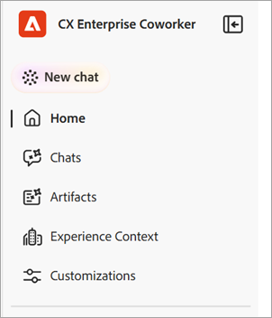
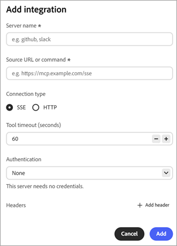

# Introdução ao Chat do Colaborador {#ui-guide}

O Bate-papo com colegas de trabalho permite que você trabalhe com seus dados e ferramentas do Adobe CX Enterprise, perguntando o que precisa em linguagem simples. Use esta página para abrir o Chat do Colaborador, enviar sua primeira mensagem e configurá-la como você trabalha.

## Disponibilidade

O [!DNL Coworker] [!UICONTROL Chat] está disponível como uma experiência imersiva, um espaço de trabalho de página inteira e como uma experiência no produto em alguns aplicativos do [!DNL CX Enterprise].

A tabela a seguir mostra onde cada experiência está disponível.

| aplicativo CX Enterprise | Experiência imersiva | Experiência no produto |
|---|---|---|
| Real-Time CDP | Disponível agora | Em breve |
| Adobe Journey Optimizer | Disponível agora | Em breve |
| Customer Journey Analytics | Disponível agora | Em breve |
| Workfront | Disponível agora | Disponível agora |
| Target | Disponível agora | Disponível agora |
| AEM | Disponível agora | Disponível agora |
| Marketo Engage | Disponível agora | Em breve |

## Entrar no [!DNL Coworker] {#sign-in}

Entre no [!DNL Coworker] usando suas credenciais da Adobe.

1. [Entre](https://experienceleague.adobe.com/pt-br/docs/core-services/interface/experience-cloud#sign-in-to-cx-enterprise) no CX Enterprise usando sua Adobe ID.

   Depois de entrar, você pode abrir o [!DNL Coworker] no menu de aplicativos [!DNL CX Enterprise] ou por meio de um link direto:

   * No [!DNL CX Enterprise], clique no menu do seletor de aplicativos  e clique em **[!DNL Coworker]**.

   * Para usar um link direto, vá para [https://experience.adobe.com/#/coworker](https://experience.adobe.com/#/coworker).

1. Para iniciar um chat, clique em **[!UICONTROL Novo chat]** no painel de navegação.

## Aprenda os conceitos básicos do Bate-papo com colegas de trabalho

>[!VIDEO](https://video.tv.adobe.com/v/3498558?learn=on)

## Especifique suas preferências de colega {#preferences}

Na parte inferior esquerda da interface, você pode especificar opções e preferências que determinam quais dados, habilidades e ferramentas conectadas uma conversa de bate-papo pode acessar.

| Configuração/opção | Use-o para |
| --- | --- |
| Nome da conta e email | Confirme a conta da Adobe com a qual você está conectado. |
| **[!UICONTROL Notificações]** (ícone de sino) | Exibir suas [notificações](https://experienceleague.adobe.com/pt-br/docs/core-services/interface/features/account-preferences#subscribe-to-notifications-in-experience-cloud). |
| **[!UICONTROL Tema]** | Alternar entre os temas Claro e Escuro. |
| **[!UICONTROL Configurações do aplicativo]** | Exibir detalhes da conta e configurações do espaço de trabalho. |
| **[!UICONTROL Preferências]** | Abra as [preferências](https://experienceleague.adobe.com/pt-br/docs/core-services/interface/features/account-preferences) da sua conta. A seta indica que a página abre fora do Co-worker. |
| **[!UICONTROL Organização]** | Escolha a [organização](https://experienceleague.adobe.com/pt-br/docs/core-services/interface/administration/organizations) do IMS na qual você deseja trabalhar. O menu mostra a organização atual e uma marca de seleção identifica a organização selecionada na lista. |
| **[!UICONTROL Sandbox]** | Escolha a [sandbox](https://experienceleague.adobe.com/pt-br/docs/experience-platform/sandbox/home) da Experience Platform na qual você deseja trabalhar. O menu mostra a sandbox atual e seu tipo, por exemplo **Prod**. |
| **[!UICONTROL Aplicativos CX]** | Vá para outro aplicativo do CX Enterprise conectado à sua conta. |
| **[!UICONTROL Sair]** | Saia da sua conta da Adobe. |

## Conheça os recursos do Colaborador {#interface-features}

O colega de trabalho tem duas áreas principais: o painel de navegação à esquerda e a janela de bate-papo que preenche o restante da tela. Para recolher o painel de navegação para que ele mostre apenas ícones, clique no ícone recolher ao lado do nome do produto.

* Painel de navegação:

  

* Janela de bate-papo (mostrada aqui com a página **[!UICONTROL Bate-papos]** aberta):

  

No painel de navegação, os seguintes recursos permitem conversar com o Colaborador e retornar ao trabalho recente:

| Opção | Use-o para |
| --- | --- |
| **[!UICONTROL Novo chat]** | Iniciar uma conversa. O [!UICONTROL Chat do Colaborador] salva o chat atual no seu histórico. |
| **[!UICONTROL Residência]** | Retorne à saudação, à caixa de entrada e aos prompts sugeridos. |
| **[!UICONTROL Bate-Papos]** | Pesquisar, fixar, arquivar ou excluir conversas anteriores. |
| **[!UICONTROL Artefatos]** | Abra os artefatos criados pelo Chat do Colaborador em suas conversas. |
| **[!UICONTROL Contexto da experiência]** | <!-- TODO: describe Experience Context --> |
| **[!UICONTROL Personalizações]** | Gerencie habilidades, integrações, marketplaces, plugins e memória. |
| **[!UICONTROL Recentes]** | Abra as conversas mais recentes. Clique em **[!UICONTROL Exibir tudo]** para abrir a página de Bate-papos. |
| **[!UICONTROL Fixado]** | Conversações abertas que você estrelou. Clique em **[!UICONTROL Exibir todos]** para vê-los na página de Bate-papos. |

## Pergunte qualquer coisa ao Colaborador {#message}

Na página inicial do Coworker, você pode digitar a pergunta ou selecionar um prompt sugerido, com base no que o Coworker Chat pode fazer na sandbox.

Para fazer uma pergunta ao Colaborador:

1. [Abrir Colaborador](#sign-in).
1. Execute um dos procedimentos a seguir:

   * Selecione um prompt em **[!UICONTROL Sugerido para você]**. O Bate-papo com colegas de trabalho o adiciona à caixa de entrada, onde você pode editá-lo.
   * Insira sua própria solicitação na caixa **[!UICONTROL Pergunte qualquer coisa ao parceiro]**.

1. (Opcional) Adicione contexto, escolha como o Chat de colaborador responde ou dita sua mensagem. Consulte [Adicionar contexto e escolha um estilo de resposta](#input-options).
1. Clique em **[!UICONTROL Enviar]**.

>[!TIP]
>
>Os prompts sugeridos mostram os tipos de tarefas compatíveis com o Coworker Chat, como mover esquemas entre sandboxes, encontrar anomalias em uma jornada e validar um conjunto de dados.

Para apontar o Chat do Colaborador para um objeto específico em sua sandbox, digite **+** na caixa de entrada e clique em um esquema, jornada, conjunto de dados ou outro objeto. Isso é chamado de menção de entidade. Ele informa ao Coworker Chat exatamente qual objeto você quer dizer.

## Adicionar contexto e escolher um estilo de resposta {#input-options}

A barra de ferramentas abaixo da caixa de entrada controla o que você anexa, como o Bate-papo com Colaborador aborda a tarefa e quanto do seu trabalho você vê.

| Controle | Use-o para |
| --- | --- |
| **[!UICONTROL +]** (Anexar) | Adicione um arquivo ou um objeto de sandbox à mensagem. |
| **[!UICONTROL Modo de plano]** | Revise um plano passo a passo antes que o Bate-papo com os colegas de trabalho aja. |
| **[!UICONTROL Modo de exibição de transcrição]** (rotulado com o modo de exibição atual, como **[!UICONTROL Normal]**) | Escolha quanto da atividade do Bate-papo de Colaborador você verá. |
| **[!UICONTROL Microfone]** | Dite sua mensagem. Clique novamente para interromper a gravação. |
| **[!UICONTROL Enviar]** (ícone de seta) | Envie sua mensagem. O controle não estará disponível até que você insira uma mensagem. Enquanto o Chat de Colaborador responde, este controle torna-se **[!UICONTROL Stop]**, o que interrompe a resposta. |

### Anexar um arquivo ou objeto

Anexe um arquivo ou objeto quando o Chat do Colaborador precisar de mais informações para fazer o trabalho.

1. Clique em **[!UICONTROL +]** na caixa de entrada.
1. Clique em uma das opções a seguir:

   * **[!UICONTROL Anexar arquivo]**: carregue um arquivo para o Chat do Colaborador para ler e fazer referência.
   * **[!UICONTROL Adicionar dados ou objeto]**: faça referência a um objeto na sandbox, como um conjunto de dados ou esquema, para que o Chat do Colaborador funcione em relação aos dados em tempo real.

### Revisar um plano antes de o Bate-papo de Colaborador agir {#plan-mode}

Use o Modo de plano para tarefas complexas ou tarefas que alteram dados. Quando o modo de Plano está ativado, o Bate-papo com colegas de trabalho propõe um plano e aguarda a sua aprovação antes de executá-lo. Quando o modo de Plano está desativado, o Bate-papo com colegas de trabalho inicia o trabalho imediatamente.

1. Clique em **[!UICONTROL Modo de plano]** na barra de ferramentas de entrada para ativá-lo.
1. Envie sua mensagem.
1. Revise o plano e aprove-o para continuar.

### Escolher uma exibição de transcrição

A visualização da transcrição controla quanto do raciocínio do Coworker Chat e a atividade da ferramenta aparecem na conversa.

1. Na barra de ferramentas de entrada, clique no controle de exibição de transcrição. Ela mostra a exibição atual, como **[!UICONTROL Normal]**.
1. Clique em uma exibição:

   | Exibir | O que você vê |
   | --- | --- |
   | **[!UICONTROL Normal]** | Um resumo das principais etapas de pensamento e atividade da ferramenta. |
   | **[!UICONTROL Foco]** | Principalmente a resposta. O Bate-papo de colega de trabalho oculta a maioria das etapas intermediárias. |
   | **[!UICONTROL Detalhado]** | Cada etapa de pensamento, carga de habilidades, leitura de arquivos e consulta. |

## Revisar uma resposta

O Bate-papo com colegas de trabalho mostra seu trabalho à medida que avança e, em seguida, retorna uma resposta. Uma resposta pode incluir seu raciocínio, um registro das ferramentas usadas, artefatos e um resumo.

Quando uma resposta for longa, clique na seta que aparece sobre a resposta para ir até o fim. O Bate-papo com colegas de trabalho exibe o seguinte aviso abaixo da caixa de entrada: &quot;As respostas são geradas usando IA e podem ser imprecisas. Verifique antes de usar.&quot; Analise as respostas antes de agir com elas.

### Acompanhar a atividade

Enquanto o Bate-papo com colegas de trabalho funciona, você pode seguir e verificar o que ele faz. Na exibição **[!UICONTROL Normal]**, um resumo de uma linha de sua atividade aparece acima da resposta, por exemplo &quot;3 habilidades carregadas, 1 arquivo lido e mais 2 etapas&quot;. Clique no resumo para expandi-lo e expanda qualquer entrada para ver mais detalhes. As entradas incluem:

* **Pensamento para**: um bloco recolhível com o raciocínio do Chat de Colaborador e quanto tempo levou.
* **Habilidade carregada**: o recurso especializado Co-worker Chat usado para a tarefa.
* **Ler arquivo** e **Executar 1 consulta**: os arquivos que o Chat do Colaborador leu e as consultas que executou, com o tempo necessário.

>[!TIP]
>
>Defina a **[!UICONTROL Exibição de transcrição]** como **[!UICONTROL Detalhada]** para ver todas as etapas, ou como **[!UICONTROL Foco]** para ocultá-las.

### Trabalhar com artefatos

O Chat do colaborador mostra resultados, como uma tabela de públicos-alvo, como cartões de artefato na resposta. Você pode baixar um artefato de tabela como um arquivo CSV de seu cartão. Quando uma resposta incluir mais de um artefato, use **[!UICONTROL Anterior]** e **[!UICONTROL Próximo]** para mover entre eles.

### Usar o resumo

Abaixo dos artefatos, o Bate-papo do Colaborador explica o que significam os resultados, destaca descobertas notáveis e sugere ações de acompanhamento. Use essas sugestões para continuar a conversa.

### Classificar e copiar uma resposta

Cada resposta inclui controles que você pode usar para fornecer feedback ou reutilizar o conteúdo.

* Clique em **[!UICONTROL Polegar para cima]** ou **[!UICONTROL Polegar para baixo]** para classificar a resposta. Sua classificação ajuda a melhorar respostas futuras.
* Clique em **[!UICONTROL Copiar]** e escolha **[!UICONTROL Copiar como Markdown]** para manter a formatação ou **[!UICONTROL Copiar como Texto sem Formatação]** para removê-la.

## Gerenciar seus chats

Seu histórico de bate-papo mantém conversas anteriores para que você possa retornar a elas. Clique em **[!UICONTROL Bate-papos]** no painel de navegação para abri-lo. As conversas são agrupadas por data e cada linha mostra o título e o número de turnos.

Na página de Bate-papos, é possível:

* Digite um nome em **[!UICONTROL Pesquisar por título]** para localizar uma conversa.
* Clique em **[!UICONTROL Mostrar fixado]** para ver apenas as conversas que você estrelou.
* Clique em **[!UICONTROL Mostrar arquivado]** para ver as conversas arquivadas.
* Clique em **[!UICONTROL Novo chat]** para iniciar uma conversa.

Para fixar, renomear, arquivar ou excluir uma conversa, clique no menu de linha (**[!UICONTROL ...]**) em sua linha e escolha uma opção.

## Personalizar bate-papo de colega

[!UICONTROL Personalizações] é onde você controla o que o [!UICONTROL Chat do Colaborador] pode fazer. Clique em **[!UICONTROL Personalizações]** no painel de navegação e escolha uma guia: **[!UICONTROL Habilidades]**, **[!UICONTROL Integrações]**, **[!UICONTROL Marketplaces]**, **[!UICONTROL Plug-ins]** ou **[!UICONTROL Memória]**.

### Adicionar e exibir habilidades

As habilidades são recursos especializados que o Bate-papo de Colaborador usa automaticamente quando se aplicam. Você também pode iniciar uma habilidade digitando **/** no chat. A guia **[!UICONTROL Habilidades]** lista cada habilidade instalada.

1. Na guia **[!UICONTROL Habilidades]**, clique em **[!UICONTROL Adicionar habilidades]** para instalar habilidades de uma nova origem.
1. Digite um nome em **[!UICONTROL Pesquisar]** para localizar uma habilidade.
Use o botão de exibição para alternar entre os layouts de grade e lista.
1. Selecione uma habilidade para ver o plug-in ao qual pertence, quando o Bate-papo do Colaborador usá-lo e os arquivos que ele inclui.

1. (Opcional) Clique em **[!UICONTROL Exibir HABILIDADE.md]** para ler a definição de habilidade completa ou clique em **[!UICONTROL Remover Source]** para desinstalar a habilidade.

### Conectar um servidor {#server}

A integração do servidor a conecta o Coworker Chat a ferramentas e serviços externos, como o Adobe Journey Optimizer, Real-Time CDP, Target e Workfront.

1. Navegue até **[!UICONTROL Personalizações]** > **[!UICONTROL Usuário]** > **[!UICONTROL Integrações]**

   

   A guia **[!UICONTROL Integrações]** lista os servidores conectados e o número de conexões ativas. Cada cartão mostra o nome do servidor, seu endpoint e tags que descrevem o que ele fornece.

1. Em Personalizações, clique em **[!UICONTROL Adicionar servidor]**.

   

1. Preencha os seguintes campos e opções:

   * **[!UICONTROL Nome do servidor]** (obrigatório): digite um nome que identifique o servidor na lista de integrações, por exemplo `github` ou `slack`.
   * **[!UICONTROL URL ou comando do Source]** (obrigatório): digite o endereço ao qual o Chat do Colaborador se conecta, por exemplo `https://mcp.example.com/sse`.
   * **[!UICONTROL Tipo de conexão]**: selecione o protocolo que o servidor usa para se comunicar com o Chat do Colaborador, **[!UICONTROL SSE]** (eventos enviados pelo servidor) ou **[!UICONTROL HTTP]**. O padrão é **[!UICONTROL SSE]**.
   * **[!UICONTROL Tempo limite da ferramenta (segundos)]**: Defina por quanto tempo o Chat do Colaborador espera uma ferramenta neste servidor responder antes de parar a solicitação. O padrão é 60 segundos.
   * **[!UICONTROL Autenticação]**: selecione como o Chat de Colaborador comprova sua identidade para o servidor. O padrão é **[!UICONTROL Nenhum]**, que não envia credenciais. Selecione outro método se o servidor exigir credenciais.
   * **[!UICONTROL Cabeçalhos]**: Clique em **[!UICONTROL Adicionar cabeçalho]** para enviar cabeçalhos HTTP extras, como uma chave de API, com cada solicitação ao servidor. Essa opção é opcional.

1. Clique em **[!UICONTROL Adicionar]**.

### Adicionar um marketplace

Um marketplace é um registro de plug-ins que você pode navegar e instalar. Na guia **[!UICONTROL Marketplaces]**, clique em **[!UICONTROL Adicionar Marketplace]** para registrar um novo. Use a **[!UICONTROL Pesquisa]** ou filtre por grupo para restringir a lista. Um marketplace com status **Pronto** está disponível para instalação.

### Gerenciar plug-ins

Um plug-in agrupa habilidades e servidores para que você possa instalá-los e gerenciá-los juntos. A guia **[!UICONTROL Plug-ins]** mostra os plug-ins instalados.

* Clique em **[!UICONTROL Procurar Marketplaces]** para encontrar novos plug-ins.
* Filtre por marketplace para ver de onde veio cada plug-in.
* Clique em **[!UICONTROL Desinstalar]** para remover um plug-in e tudo o que ele empacota.

### Gerenciar memória

A memória permite que o Bate-papo com colegas de trabalho lembre de suas preferências nas conversas, para que as respostas permaneçam relevantes ao longo do tempo. Use a guia **[!UICONTROL Memória]** para controlar o que ela mantém.

1. Clique em **[!UICONTROL Memória]** na página Personalizações.
1. Ativar **[!UICONTROL Habilitar memória]**. Desative para impedir que o Bate-papo de Colaborador lembre-se entre sessões.
1. Em **[!UICONTROL Preferências armazenadas]**, verifique o que o Chat do Colaborador salvou. É possível editar, excluir ou inspecionar cada entrada e filtrar entradas por categoria.
1. Use o **[!UICONTROL Histórico de memórias salvas]** para ver uma linha do tempo de alterações em suas memórias.

