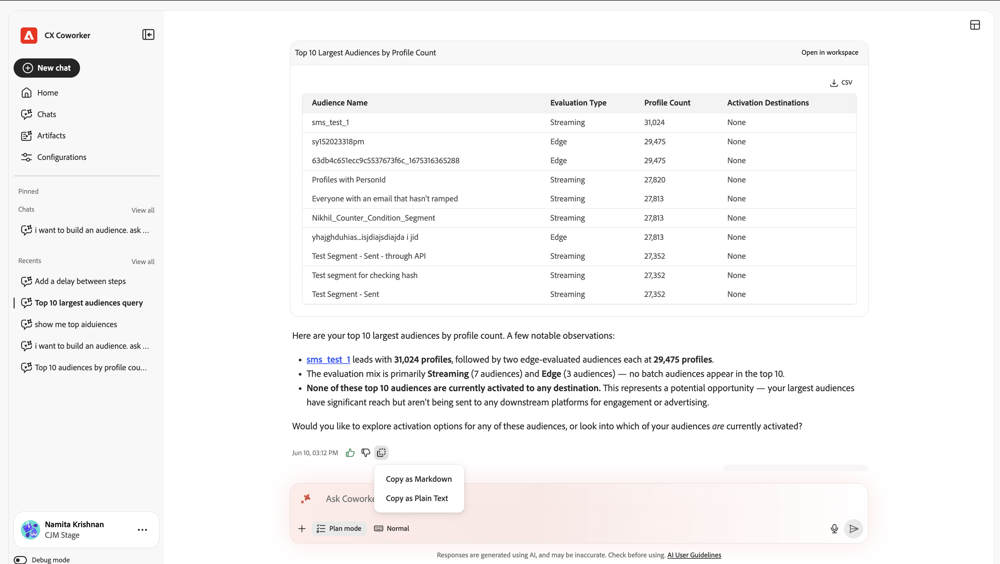
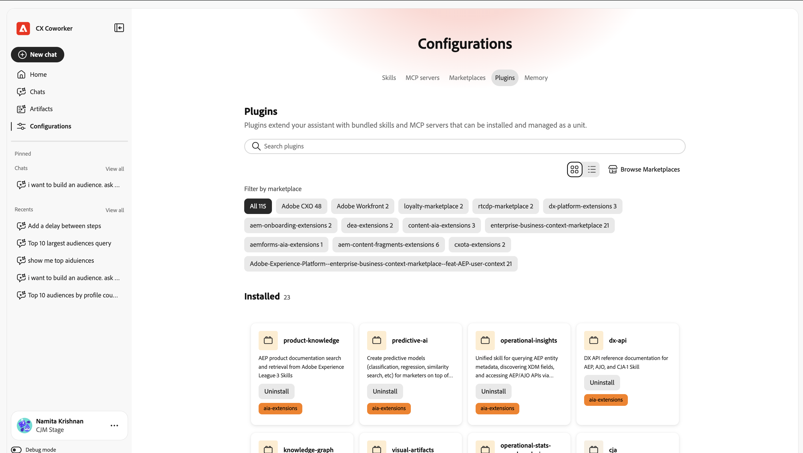

# Introdução ao Chat do Colaborador {#ui-guide}

O Bate-papo com colegas de trabalho permite que você trabalhe com seus dados e ferramentas do Adobe CX Enterprise, perguntando o que precisa em linguagem simples. Use esta página para abrir o Chat do Colaborador, enviar sua primeira mensagem e configurá-la como você trabalha.

>[!VIDEO](https://video.tv.adobe.com/v/3498571?captions=por_br&learn=on)

## Disponibilidade

O Chat do colaborador está disponível como uma experiência imersiva, um espaço de trabalho de página inteira e como uma experiência no produto em alguns aplicativos do CX Enterprise. Para abrir a experiência no produto, clique no ícone do Colaborador  na parte superior direita do aplicativo.

A tabela a seguir mostra onde cada experiência está disponível.

| aplicativo CX Enterprise | Experiência imersiva | Experiência no produto |
|---|---|---|
| Real-Time CDP | Disponível agora | Em breve |
| Adobe Journey Optimizer | Disponível agora | Em breve |
| Customer Journey Analytics | Disponível agora | Em breve |
| Workfront | Disponível agora | Em breve:  * início de setembro de 2026 na instância de Pré-visualização para administradores de sistema Workfront selecionados  * meados de setembro de 2026 na instância de Produção para clientes Workfront de lançamento rápido qualificados  * meados de outubro de 2026 na instância de Produção para clientes Workfront de lançamento trimestral qualificados |
| Target | Disponível agora | Disponível agora |
| AEM | Disponível agora | Disponível agora |
| Marketo Engage | Disponível agora | Em breve |

## Abrir Chat do Colaborador {#immersive}

Para usar a experiência imersiva, entre com as credenciais da Adobe. É possível abri-lo por um link direto ou dentro do CX Enterprise.

1. Ir para [https://experience.adobe.com/#/coworker](https://experience.adobe.com/#/coworker).
1. Faça logon com sua Adobe ID.

Como alternativa, clique em **[!UICONTROL Colaborador]** no seletor de aplicativos, no cabeçalho do CX Enterprise.

## Escolha sua organização

Sua [organização](https://experienceleague.adobe.com/pt-br/docs/core-services/interface/administration/organizations) e sandbox determinam quais dados, habilidades e ferramentas conectadas uma conversa pode acessar. Verifique-as antes de começar. O contexto atual é exibido na parte inferior do painel de navegação esquerdo, sob seu nome.

Para alterar o contexto:

1. Clique no seu nome na parte inferior do painel de navegação para abrir o menu de conta.
1. Clique em **[!UICONTROL Organização]** e escolha a organização IMS na qual deseja trabalhar.

   

1. Clique em **[!UICONTROL Sandbox]** e escolha a sandbox da AEP em que deseja trabalhar.

   

O menu de conta também inclui as seguintes opções:

| Opção | Use-o para |
| --- | --- |
| **[!UICONTROL Tema]** | Alternar entre os temas Claro e Escuro. |
| **[!UICONTROL Configurações]** | Exibir detalhes da conta e configurações do espaço de trabalho. |
| **[!UICONTROL Aplicativos CX]** | Vá para outro aplicativo do CX Enterprise conectado à sua conta. |
| **[!UICONTROL Sair]** | Saia da sua conta da Adobe. |

## Encontre o seu caminho

O espaço de trabalho tem duas áreas: o painel de navegação à esquerda e a tela de conversa que preenche o restante da janela.

Use o painel de navegação para se mover entre as partes do produto e retornar ao trabalho recente.

| Opção | Use-o para |
| --- | --- |
| **[!UICONTROL Novo chat]** | Iniciar uma conversa. O Bate-papo de Colaborador salva o bate-papo atual no seu histórico. |
| **[!UICONTROL Residência]** | Retorne à saudação, à caixa de entrada e aos prompts sugeridos. |
| **[!UICONTROL Bate-Papos]** | Pesquisar, fixar, arquivar ou excluir conversas anteriores. |
| **[!UICONTROL Configurações]** | Gerencie habilidades, servidores MCP, marketplaces, plugins e memória. |
| **[!UICONTROL Fixado]** | Conversações abertas que você estrelou. Clique em **[!UICONTROL Exibir todos]** para vê-los na página de Bate-papos. |
| **[!UICONTROL Recentes]** | Abra as conversas mais recentes. Clique em **[!UICONTROL Exibir tudo]** para abrir a página de Bate-papos. |

## Envie sua primeira mensagem

A tela inicial mostra uma saudação, a caixa de entrada ([!UICONTROL Chat]) e os prompts sugeridos com base no que o Chat de Colaborador pode fazer na sua sandbox. Você pode começar com uma sugestão ou escrever sua própria mensagem.

Para enviar uma mensagem:

1. Clique em **[!UICONTROL Página inicial]** no painel de navegação.
1. Execute um dos procedimentos a seguir:

   * Selecione um prompt em **[!UICONTROL Sugerido para você]**. O Bate-papo com colegas de trabalho o adiciona à caixa de entrada, onde você pode editá-lo.
   * Insira sua própria solicitação na caixa **[!UICONTROL Pergunte qualquer coisa ao parceiro]**.

1. (Opcional) Adicione contexto, escolha como o Chat de colaborador responde ou dita sua mensagem. Consulte [Adicionar contexto e escolha um estilo de resposta](#input-options).
1. Clique em **[!UICONTROL Enviar]**.

>[!TIP]
>
>Os prompts sugeridos mostram os tipos de tarefas compatíveis com o Coworker Chat, como mover esquemas entre sandboxes, encontrar anomalias em uma jornada e validar um conjunto de dados.

Para apontar o Chat do Colaborador para um objeto específico em sua sandbox, digite **+** na caixa de entrada e clique em um esquema, jornada, conjunto de dados ou outro objeto. Isso é chamado de menção de entidade. Ele informa ao Coworker Chat exatamente qual objeto você quer dizer.

## Adicionar contexto e escolher um estilo de resposta {#input-options}

A barra de ferramentas abaixo da caixa de entrada controla o que você anexa, como o Bate-papo com Colaborador aborda a tarefa e quanto do seu trabalho você vê.

| Controle | Use-o para |
| --- | --- |
| **[!UICONTROL +]** (Anexar) | Adicione um arquivo ou um objeto de sandbox à mensagem. |
| **[!UICONTROL Modo de plano]** | Revise um plano passo a passo antes que o Bate-papo com os colegas de trabalho aja. |
| **[!UICONTROL Modo de exibição de transcrição]** | Escolha quanto da atividade do Bate-papo de Colaborador você verá. |
| **[!UICONTROL Microfone]** | Dite sua mensagem. Clique novamente para interromper a gravação. |
| **[!UICONTROL Enviar]** | Envie sua mensagem. Enquanto o Chat de Colaborador responde, este controle torna-se **[!UICONTROL Stop]**, o que interrompe a resposta. |

### Anexar um arquivo ou objeto

Anexe um arquivo ou objeto quando o Chat do Colaborador precisar de mais informações para fazer o trabalho.

1. Clique em **[!UICONTROL +]** na caixa de entrada.
1. Clique em uma das opções a seguir:

   * **[!UICONTROL Anexar arquivo]**: carregue um arquivo para o Chat do Colaborador para ler e fazer referência.
   * **[!UICONTROL Adicionar dados ou objeto]**: faça referência a um objeto na sandbox, como um conjunto de dados ou esquema, para que o Chat do Colaborador funcione em relação aos dados em tempo real.

### Revisar um plano antes de o Bate-papo de Colaborador agir {#plan-mode}

Use o Modo de plano para tarefas complexas ou tarefas que alteram dados. Quando o modo de Plano está ativado, o Bate-papo com colegas de trabalho propõe um plano e aguarda a sua aprovação antes de executá-lo. Quando o modo de Plano está desativado, o Bate-papo com colegas de trabalho inicia o trabalho imediatamente.

1. Clique em **[!UICONTROL Modo de plano]** na barra de ferramentas de entrada para ativá-lo.
1. Envie sua mensagem.
1. Revise o plano e aprove-o para continuar.

### Escolher uma exibição de transcrição

A visualização da transcrição controla quanto do raciocínio do Coworker Chat e a atividade da ferramenta aparecem na conversa.

1. Clique em **[!UICONTROL Modo de exibição de transcrição]** na barra de ferramentas de entrada.
1. Clique em uma exibição:

   | Exibir | O que você vê |
   | --- | --- |
   | **[!UICONTROL Normal]** | Um resumo das principais etapas de pensamento e atividade da ferramenta. |
   | **[!UICONTROL Foco]** | Principalmente a resposta. O Bate-papo de colega de trabalho oculta a maioria das etapas intermediárias. |
   | **[!UICONTROL Detalhado]** | Cada etapa de pensamento, carga de habilidades, leitura de arquivos e consulta. |

## Revisar uma resposta

O Bate-papo com colegas de trabalho mostra seu trabalho à medida que avança e, em seguida, retorna uma resposta. Uma resposta pode incluir seu raciocínio, um registro das ferramentas usadas, artefatos e um resumo.

### Acompanhar a atividade

Enquanto o Bate-papo com colegas de trabalho funciona, você pode seguir e verificar o que ele faz. Expanda qualquer entrada para ver mais detalhes.

* **Pensamento para**: um bloco recolhível com o raciocínio do Chat de Colaborador e quanto tempo levou.
* **Habilidade carregada**: o recurso especializado Co-worker Chat usado para a tarefa.
* **Ler arquivo** e **Executar 1 consulta**: os arquivos que o Chat do Colaborador leu e as consultas que executou, com o tempo necessário.

>[!TIP]
>
>Defina a **[!UICONTROL Exibição de transcrição]** como **[!UICONTROL Detalhada]** para ver todas as etapas, ou como **[!UICONTROL Foco]** para ocultá-las.

### Trabalhar com artefatos

O Chat do colaborador mostra resultados, como uma tabela de públicos-alvo, como cartões de artefato na resposta. Você pode baixar um artefato de tabela como um arquivo CSV de seu cartão. Quando uma resposta incluir mais de um artefato, use **[!UICONTROL Anterior]** e **[!UICONTROL Próximo]** para mover entre eles.

### Usar o resumo

Abaixo dos artefatos, o Bate-papo do Colaborador explica o que significam os resultados, destaca descobertas notáveis e sugere ações de acompanhamento. Use essas sugestões para continuar a conversa.

### Classificar e copiar uma resposta

Cada resposta inclui controles que você pode usar para fornecer feedback ou reutilizar o conteúdo.

* Clique em **[!UICONTROL Polegar para cima]** ou **[!UICONTROL Polegar para baixo]** para classificar a resposta. Sua classificação ajuda a melhorar respostas futuras.
* Clique em **[!UICONTROL Copiar]** e escolha **[!UICONTROL Copiar como Markdown]** para manter a formatação ou **[!UICONTROL Copiar como Texto sem Formatação]** para removê-la.

## Gerenciar seus chats

Seu histórico de bate-papo mantém conversas anteriores para que você possa retornar a elas. Clique em **[!UICONTROL Bate-papos]** no painel de navegação para abri-lo. As conversas são agrupadas por data e cada linha mostra o título e o número de turnos.

Na página de Bate-papos, é possível:

* Digite um nome em **[!UICONTROL Pesquisar por título]** para localizar uma conversa.
* Clique em **[!UICONTROL Mostrar fixado]** para ver apenas as conversas que você estrelou.
* Clique em **[!UICONTROL Mostrar arquivado]** para ver as conversas arquivadas.
* Clique em **[!UICONTROL Novo chat]** para iniciar uma conversa.

Para fixar, renomear, arquivar ou excluir uma conversa, clique no menu de linha (**[!UICONTROL ...]**) em sua linha e escolha uma opção.

## Personalizar bate-papo de colega

As configurações são onde você controla o que o Chat de Colaborador pode fazer. Clique em **[!UICONTROL Configurações]** no painel de navegação e escolha uma guia: **[!UICONTROL Habilidades]**, **[!UICONTROL Servidores MCP]**, **[!UICONTROL Marketplaces]**, **[!UICONTROL Plug-ins]** ou **[!UICONTROL Memória]**.

### Adicionar e exibir habilidades

As habilidades são recursos especializados que o Bate-papo de Colaborador usa automaticamente quando se aplicam. Você também pode iniciar uma habilidade digitando **/** no chat. A guia **[!UICONTROL Habilidades]** lista cada habilidade instalada.

1. Na guia **[!UICONTROL Habilidades]**, clique em **[!UICONTROL Adicionar Source]** para instalar habilidades de uma nova origem.
1. Digite um nome em **[!UICONTROL Pesquisar]** para localizar uma habilidade. Use o botão de exibição para alternar entre os layouts de grade e lista.
1. Selecione uma habilidade para ver o plug-in ao qual pertence, quando o Bate-papo do Colaborador usá-lo e os arquivos que ele inclui.

   

1. (Opcional) Clique em **[!UICONTROL Exibir HABILIDADE.md]** para ler a definição de habilidade completa ou clique em **[!UICONTROL Remover Source]** para desinstalar a habilidade.

   

### Conectar servidores MCP

Os servidores de Protocolo de Contexto de Modelo (MCP) conectam o Coworker Chat a ferramentas e serviços externos, como Adobe Journey Optimizer, Real-Time CDP, Target e Workfront. A guia **[!UICONTROL Servidores MCP]** lista os servidores conectados e o número de conexões ativas. Cada cartão mostra o nome do servidor, seu endpoint e tags que descrevem o que ele fornece.

Para conectar um servidor, clique em **[!UICONTROL Adicionar servidor]** e siga as instruções.

### Adicionar um marketplace

Um marketplace é um registro de plug-ins que você pode navegar e instalar. Na guia **[!UICONTROL Marketplaces]**, clique em **[!UICONTROL Adicionar Marketplace]** para registrar um novo. Use a **[!UICONTROL Pesquisa]** ou filtre por grupo para restringir a lista. Um marketplace com status **Pronto** está disponível para instalação.

### Gerenciar plug-ins

Um plug-in agrupa habilidades e servidores MCP para que você possa instalá-los e gerenciá-los juntos. A guia **[!UICONTROL Plug-ins]** mostra os plug-ins instalados.

* Clique em **[!UICONTROL Procurar Marketplaces]** para encontrar novos plug-ins.
* Filtre por marketplace para ver de onde veio cada plug-in.
* Clique em **[!UICONTROL Desinstalar]** para remover um plug-in e tudo o que ele empacota.

### Gerenciar memória

A memória permite que o Bate-papo com colegas de trabalho lembre de suas preferências nas conversas, para que as respostas permaneçam relevantes ao longo do tempo. Use a guia **[!UICONTROL Memória]** para controlar o que ela mantém.

1. Clique em **[!UICONTROL Memória]** na página Configurações.
1. Ativar **[!UICONTROL Habilitar memória]**. Desative para impedir que o Bate-papo de Colaborador lembre-se entre sessões.
1. Em **[!UICONTROL Preferências armazenadas]**, verifique o que o Chat do Colaborador salvou. É possível editar, excluir ou inspecionar cada entrada e filtrar entradas por categoria.
1. Use o **[!UICONTROL Histórico de memórias salvas]** para ver uma linha do tempo de alterações em suas memórias.

