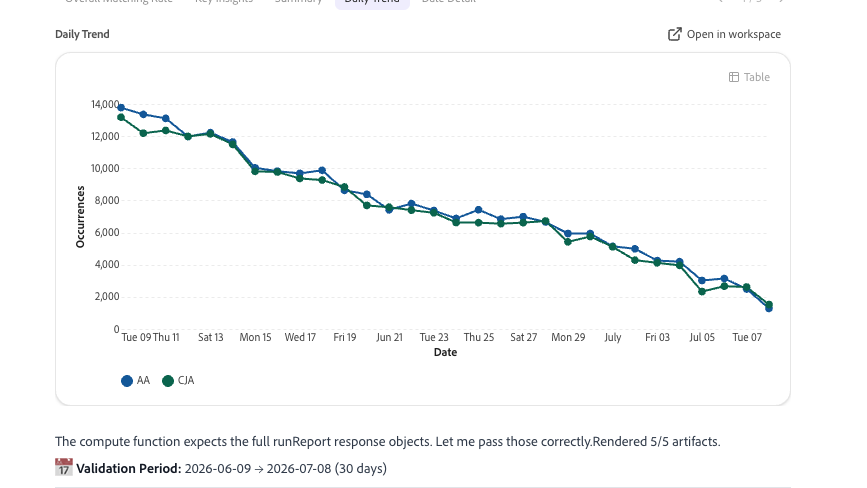

# Visão geral do desempenho empresarial

<!-- FLAG: Confidence: High for the first sentence and "Best for" (carried over from analytics-overview.md). Medium for the second sentence, which summarizes the row descriptions. -->

Use o Adobe CX Enterprise Coworker Chat para entender como a empresa está se saindo, por que uma métrica foi movida, para onde está indo e o que fazer em seguida. Investigue alterações em suas métricas principais, projete-as e transforme seus resultados em resumos prontos para as partes interessadas e habilidades reutilizáveis.

O desempenho comercial é um dos vários domínios de análise no Chat do colaborador. Para ver todos os domínios, consulte [Iniciar análise no Chat do Colaborador](/help/chat/use-cases/data-insights/analytics-overview.md#start-analyzing-in-coworker-chat) em Analisar dados com o Chat do Colaborador.

**Recomendado para:** Analista, Usuário empresarial

## Pré-requisitos

Para usar os casos de uso nesta página, você precisa:

* O Bate-papo com colegas de trabalho conectou-se às visualizações de dados do Customer Journey Analytics ou aos conjuntos de relatórios do Adobe Analytics. Consulte [Introdução à análise de dados com o Chat de Colaborador](/help/chat/use-cases/data-insights/analytics-chat.md).
* Acesso de visualização às visualizações de dados ou conjuntos de relatórios que você deseja analisar. O Chat do colega herda suas permissões do Customer Journey Analytics ou do Adobe Analytics.

## Casos de uso

| Caso de uso | Função |
| --- | --- |
| [Explorar tendências e causas básicas](/help/chat/use-cases/data-insights/root-cause-analysis.md)

 | Identifica tendências em seus dados do Customer Journey Analytics e do Adobe Analytics e os fatores que impulsionam alterações no desempenho, sem consultas manuais.
**Exemplo de prompt:** &quot;Por que as conversões caíram na semana passada?&quot;

Para obter mais informações, consulte [Customer Journey Analytics e Colaborador](/help/chat/use-cases/data-insights/root-cause-analysis.md).
 |
| [Explicar por que uma métrica foi movida](/help/chat/use-cases/data-insights/analytics-overview.md#skills-and-limitations) | Executa uma análise de causa básica que supera as dimensões e os segmentos atrás de uma alteração e exclui o restante.
**Prompts de exemplo:**
<ul><li>&quot;Por que a receita aumentou na terça-feira?&quot;</li><li>&quot;O que impulsionou a mudança nas sessões deste mês?&quot;</li></ul>
Para obter mais informações, consulte [Habilidades e limitações](/help/chat/use-cases/data-insights/analytics-overview.md#skills-and-limitations).
 |
| [Preparar revisões de desempenho empresarial](/help/chat/use-cases/data-insights/analytics-overview.md#skills-and-limitations) | Transforma métricas confiáveis em uma história de desempenho explicada, com descobertas e próximas etapas recomendadas.
**Prompts de exemplo:**
<ul><li>&quot;Dê-me um resumo executivo do mês passado&quot;</li><li>&quot;Resuma o desempenho para a equipe de liderança&quot;</li></ul>
Para obter mais informações, consulte [Habilidades e limitações](/help/chat/use-cases/data-insights/analytics-overview.md#skills-and-limitations).
 |
| [Previsão de onde uma métrica está indo](/help/chat/use-cases/data-insights/analytics-overview.md#skills-and-limitations) | Projeta uma métrica a partir de dados históricos para que você possa ver o resultado de um erro.
**Prompts de exemplo:**
<ul><li>&quot;Sessões de previsão para os próximos 30 dias&quot;</li><li>&quot;Estamos no caminho para atingir nossa meta de receita?&quot;</li></ul>
Para obter mais informações, consulte [Habilidades e limitações](/help/chat/use-cases/data-insights/analytics-overview.md#skills-and-limitations).
 |
| [Criar habilidades personalizadas do Customer Journey Analytics](/help/chat/use-cases/data-insights/analytics-overview.md#skills-and-limitations) | Transforme uma análise que você repete em uma habilidade reutilizável que persiste entre as sessões.
**Exemplo de prompt:** &quot;Transformar esta análise semanal de receita em uma habilidade reutilizável&quot;

**Pré-requisito adicional:** Além dos [pré-requisitos gerais](#prerequisites), este caso de uso também requer a permissão Gerenciar habilidades.

Para obter mais informações, consulte [Habilidades e limitações](/help/chat/use-cases/data-insights/analytics-overview.md#skills-and-limitations).
 |
| [Repetir análise bem-sucedida nos mercados](/help/chat/use-cases/data-insights/analytics-overview.md#skills-and-limitations) | Aplica uma abordagem analítica comprovada em marcas, regiões ou unidades de negócios.
**Recomendado para:** analista

**Prompt de exemplo:** &quot;Executar minha habilidade semanal do funnel para a visualização de dados do EMEA&quot;

Para obter mais informações, consulte [Habilidades e limitações](/help/chat/use-cases/data-insights/analytics-overview.md#skills-and-limitations).
 |

## Habilidades usadas

<!-- FLAG: Confidence: High for the root cause analysis skills, `cja-executive-summary`, forecasting with `cja` and `aa`, and `cja-skill-creator` for creating skills. All are listed in the Skills and limitations table and in workflows.md. Medium for mapping Repeat successful analysis across markets to `cja-skill-creator`: the row describes running a saved skill, which is inferred. workflows.md also lists `cja-bacom-anomaly-tracker-v2`, `cja-cno-weekly-pulse`, and `cja-reporting` for executive summaries. They're left out because they look org-specific. Confirm with the PM. -->

O colaborador usa as seguintes habilidades para os casos de uso descritos neste artigo. Para obter uma lista de todas as habilidades de análise, incluindo as permissões necessárias e as que não são abordadas, consulte [Habilidades e limitações](/help/chat/use-cases/data-insights/analytics-overview.md#skills-and-limitations) em Analisar dados com o Chat do Colaborador.

| Habilidade | Usado para |
| --- | --- |
| `cja-root-cause-analysis`, `aa-root-cause-analysis` | Explorar tendências e causas raiz Explicar por que uma métrica foi movida |
| `cja-executive-summary` | Preparar revisões de desempenho de negócios |
| `cja`, `aa` | Previsão para a qual uma métrica está sendo direcionada |
| `cja-skill-creator` | Criar habilidades personalizadas do Customer Journey Analytics Repetir análise bem-sucedida entre mercados |

## Dicas para obter melhores resultados

* Nomeie a métrica e o período da alteração que você deseja investigar. A análise da causa principal funciona em uma métrica conhecida durante um período conhecido.
* Solicite as dimensões de contribuição se desejar um detalhamento de uma alteração de métrica.
* Solicitar um horizonte de previsão, como &quot;próximos 30 dias&quot;, ao projetar métricas.
* Especifique o público-alvo para um resumo, como liderança ou a equipe de marketing, e solicite uma descrição do conjunto de slides se planeja apresentar os resultados.
* Conclua uma análise primeiro e depois peça ao bate-papo com colegas de trabalho para salvá-la como uma habilidade. Dê à habilidade um nome claro e descritivo e observe com que frequência você planeja reutilizá-la.

## Próximas etapas

* Para obter uma visão geral da análise de dados com o Chat do Colaborador, incluindo os outros domínios de análise e práticas recomendadas, consulte [Analisar dados com o Chat do Colaborador](/help/chat/use-cases/data-insights/analytics-overview.md).
* Para ver a análise da causa raiz em ação, consulte [Customer Journey Analytics e Colaborador](/help/chat/use-cases/data-insights/root-cause-analysis.md).
