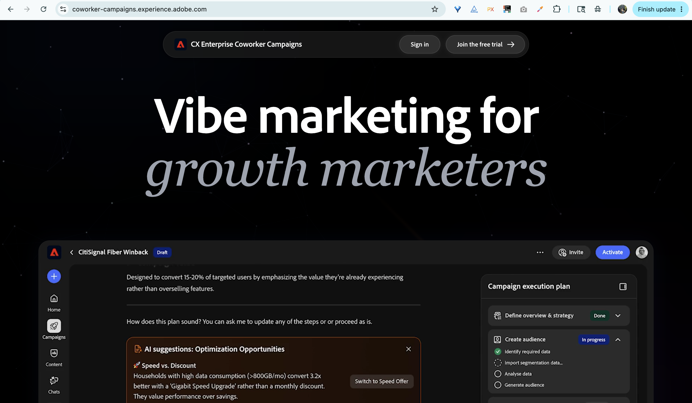

# Colaborador para visão geral de equipes {#overview}

O Co-worker para equipes foi projetado para organizações menores com equipes de marketing mais ágeis que precisam de geração de conteúdo, criação de jornadas e análise em uma única ferramenta.

No momento, todas as interações com a IA o direcionarão para a [geração de campanha](/help/coworker-for-teams/create-an-email-campaign.md). Mais funcionalidades serão disponibilizadas em breve.

## Como acessar o

>[!NOTE]
>
>O colega de trabalho para equipes está disponível por meio de avaliação gratuita até 31 de dezembro de 2026. Durante a avaliação, todos os ativos e atividades são específicos do usuário.

1. Acesse coworker-campaigns.experience.adobe.com.

1. Se você tiver uma conta existente do Adobe, clique em **Entrar**. Caso contrário, clique em **Participe da avaliação gratuita** e crie uma conta usando o email comercial.

   Os clientes atuais do Adobe são aprovados automaticamente e encaminhados diretamente para o ambiente de avaliação para aceitar os termos.

   Se você não for um cliente existente, solicite acesso selecionando **Criar uma conta**. O Adobe revisa solicitações e aprova emails comerciais. Você receberá um email quando sua solicitação for aprovada (certifique-se de verificar a pasta Spam).

1. Aceite os termos de avaliação.

1. Configure sua marca em **Seus itens** > **Marcas**. O colega de trabalho das equipes usa isso como padrão para cada campanha gerada.

1. (Opcional) Carregue um modelo de email do HTML em **Modelos de email** para o Colaborador, para que as equipes apliquem seu design ao gerar conteúdo.

   {width="800" zoomable="yes"}

Você está pronto para gerar sua primeira campanha.

## Um tour pela interface

A interface de Colaborador de equipes é organizada em torno de uma navegação à esquerda.

| Menu de navegação esquerdo | Finalidade |
|---|---|
| Novo bate-papo | Inicie uma nova conversa para gerar uma campanha. |
| Início | Seu ponto de partida: barra de prompts, campanhas recentes e templates de campanha prontos. |
| Chats | Todas as conversas que você iniciou que ainda não foram geradas em um quadro de campanha. |
| Campanhas | Seu inventário de todas as campanhas de rascunho e ativas. |
| Suas coisas | Os kits da sua marca e os modelos de email (o colaborador de ativos das equipes usa o para manter tudo sob a marca). |
| Personalizar | Conectores (Marketo Engage no lançamento) e habilidades (comportamentos personalizados que você pode aplicar em campanhas). |

>[!NOTE]
>
>No lançamento, todas as conversas no Colaborador para equipes se concentram na geração de uma campanha. As conversas no estilo ideação, análise e suporte serão lançadas progressivamente.

## O que você pode fazer com o colega de trabalho para equipes

O colega de trabalho para equipes reúne cinco fluxos de trabalho que geralmente abrangem cinco ferramentas diferentes em uma experiência de conversação:

- **Transformar um resumo em um plano de campanha**. Solte em um prompt ou faça upload de um resumo, e o Colaborador de equipes retorna um plano estruturado e completo.
- **Criar e refinar públicos**. Carregue um CSV ou conecte seus dados e refine o segmento na conversa.
- **Gerar conteúdo sobre a marca**. O colega de trabalho das equipes grava emails que correspondem à voz, às referências e aos modelos da sua marca.
- **Criar jornadas de várias etapas**. Colaborador de equipes monta sequências de criação, não apenas envios únicos.
- **Enviar emails de prova**. Visualize cada mensagem em sua própria caixa de entrada antes do lançamento.
- **Iniciar e analisar**. _(Em breve)_ Envie campanhas e obtenha os melhores insights da próxima etapa sem sair do Colaborador para as equipes.

## Como a IA funciona

O colega de trabalho para equipes segue um loop conversacional simples de várias rodadas:

**Entrada**. Você fornece uma meta de campanha, seu público-alvo (carregado ou conectado) e o contexto opcional da marca.

**Processando**. O Colaborador para equipes do Agentic AI gera um plano de campanha, cria uma jornada e rascunha conteúdo personalizado. Tudo o que você pode atualizar, conversacionalmente.

**Saída**. Um rascunho de campanha é exibido no quadro de campanha, pronto para revisão, iteração e eventual lançamento.

Você pode conversar com os colegas de trabalho sobre equipes a qualquer momento (por exemplo, &quot;tornar o segundo email mais urgente&quot;, &quot;encurtar as linhas de assunto&quot; ou &quot;trocar o público-alvo para clientes antigos do 3º trimestre&quot;) e os artefatos serão atualizados no local.

>[!CAUTION]
>
>Sempre verifique as saídas antes de enviar.

## Dicas para começar

Alguns achados dos primeiros usuários que fazem uma diferença real:

- **Comece com um caso de uso real e específico**. &quot;Crie uma série de reconquista para clientes que não fizeram pedidos em 90 dias&quot; bate &quot;faça-me uma campanha&quot;. Consulte _Casos de uso_ para obter exemplos específicos.
- **Limpar os dados do público-alvo**. O colega de trabalho das equipes só pode personalizar, assim como o CSV permite. Exclua todos os contatos para os quais você não deve enviar emails antes de fazer upload.
- **Invista na configuração da sua marca**. Colaborador para equipes extrai detalhes da marca quando você se inscreve. Uma análise rápida de **Seus itens** > **Marcas** beneficia cada campanha gerada.
- **Enviar um email de prova**. Antes de iniciar, envie uma prova e revise-a na sua própria caixa de entrada.
- **Iterar, não reiniciar**. Trate o Colaborador para saída de equipes primeiro como um ponto de partida. O caminho mais rápido para o ótimo é algumas rodadas de refinamento, não um prompt novo.
- **Exporte quando precisar de uma trilha de papel**. Exporte emails individuais como HTML ou a campanha completa como um documento do Word ou PDF para análise da equipe.
- **A chave de escape**. Pressione a tecla escape sempre que estiver em um editor de Colaborador de campanhas ou em uma caixa de diálogo (campanhas, jornada etc.) para sair rapidamente.

## O que saber sobre o julgamento

O colega de trabalho para equipes é um produto em desenvolvimento ativo. Veja o que você deve saber sobre a entrada:

- **Janela de avaliação**: até 31 de dezembro de 2026.
- **Aceitação necessária**: você precisará revisar e aceitar os termos de avaliação antes de acessar o produto.
- **Região**: a avaliação gratuita está disponível somente para usuários na América do Norte no momento.
- **Públicos-alvo**: os públicos-alvo são carregados via CSV. Todos os públicos-alvo são específicos para suas respectivas campanhas (eles não são armazenados em nenhum outro lugar do seu ambiente no momento).
- **Orientação de dados**: não carregar dados confidenciais ou regulamentados. Atualmente, os colegas de trabalho para equipes não se destinam a setores regulamentados pela HIPAA.
- **Conformidade**: você é responsável pelas seguintes regulamentações de email (links de cancelamento de inscrição, políticas de privacidade, etc.).
- **Limite de envio**: (_Em breve_) Quando o Launch estiver disponível, você poderá enviar até 5.000 emails por mês.

## Visão geral do vídeo

>[!VIDEO](https://video.tv.adobe.com/v/3492807?learn=on){transcript=true}

Novos recursos serão enviados durante a avaliação. Seus comentários ajudam a moldar o que vem a seguir. Envie feedback por meio do ícone de feedback no produto, no cabeçalho.
