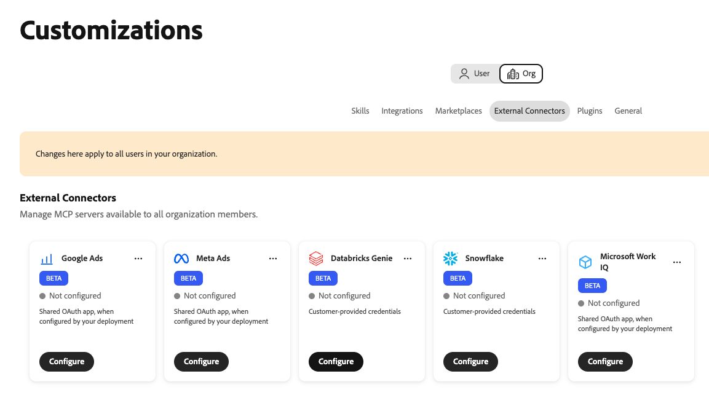
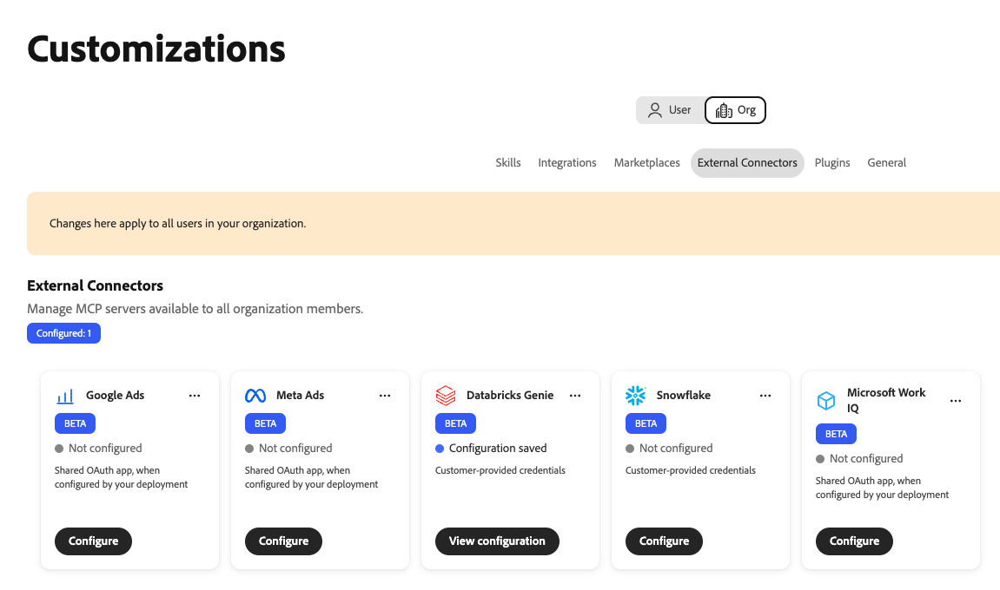
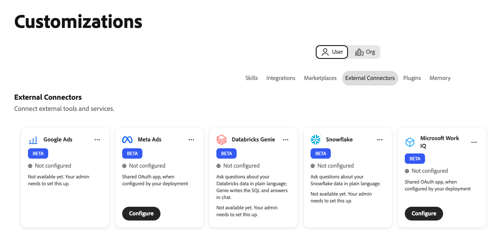

# Conector externo do Databricks Genie {#databricks-genie}

Use o conector externo do [!DNL Databricks Genie] para fazer perguntas sobre seus dados do [!DNL Databricks] em linguagem simples no Adobe CX Enterprise Coworker. [!DNL Genie] grava o SQL e retorna as respostas no chat. O conector vincula o Colaborador ao servidor MCP [!DNL Genie One] no espaço de trabalho [!DNL Databricks].

>[!AVAILABILITY]
>
>O conector externo [!DNL Databricks Genie] está na versão beta. A documentação e a funcionalidade estão sujeitas a alterações.

## Configuração do conector {#connector-configuration}

O processo de configuração do conector tem duas partes separadas:

* **Configuração da organização:** um administrador conecta o Coworker a um espaço de trabalho [!DNL Databricks], escolhe como as pessoas entram e seleciona as ferramentas que os membros podem usar.
* **Acesso de membro:** os membros usam a conexão com uma identidade de organização compartilhada ou sua própria identidade [!DNL Databricks], dependendo da opção de entrada.

O administrador escolhe uma das seguintes opções de logon:

| Opção | O que o administrador oferece | Como o acesso funciona |
| --- | --- | --- |
| **[!UICONTROL Entidade de serviço da organização]** | A ID do cliente e o segredo do cliente de uma entidade de serviço [!DNL Databricks]. | Todos os membros usam as permissões da entidade de serviço. Os membros não entram no [!DNL Databricks]. |
| **[!UICONTROL Cada pessoa entra]** | A ID de cliente de uma conexão de aplicativo OAuth [!DNL Databricks] e um segredo de cliente opcional. | Cada membro entra com sua própria identidade [!DNL Databricks], e o acesso segue suas permissões [!DNL Databricks]. |

Nenhuma opção concede [!DNL Databricks] permissões que a identidade selecionada ainda não tem. [!DNL Databricks] impõe [!DNL Unity Catalog] permissões em cada solicitação.

## Pré-requisitos {#prerequisites}

Este conector funciona com [!DNL Databricks Genie One]. Não há suporte para URLs MCP de espaço [!DNL Genie] herdadas. Para conectar outro servidor MCP [!DNL Databricks], como um servidor [!DNL Databricks SQL], adicione-o separadamente como uma integração.

Antes de começar, verifique se você tem o seguinte:

* **Para configuração de organização:** uma conta com permissão para gerenciar conectores de organização no Colaborador.
* **Para o espaço de trabalho [!DNL Databricks]:** A URL HTTPS de um espaço de trabalho onde [!DNL Genie One] está disponível.
* **Para a opção de entidade de serviço:** A ID do cliente e o segredo do cliente de uma entidade de serviço [!DNL Databricks].
* **Para a opção de entrada por pessoa:** Uma conexão de aplicativo OAuth [!DNL Databricks] e sua ID de cliente. Você também precisa de um administrador [!DNL Databricks] que possa registrar a URL de redirecionamento do Colaborador.
* **Para [!DNL Databricks], acesse:** Workspace, [!DNL Genie] e permissões de dados para a identidade que será usada. O colega de trabalho não concede essas permissões.

>[!IMPORTANT]
>
>Nunca compartilhe segredos do cliente, tokens de acesso ou outras credenciais em capturas de tela, bate-papos ou tíquetes de suporte.

Para obter instruções, consulte a seguinte documentação do [!DNL Databricks]:

* [Genie One MCP](https://docs.databricks.com/aws/en/agents/mcp-tools/genie-mcp){target="_blank"}
* [Habilitar ou desabilitar aplicativos OAuth de parceiros](https://docs.databricks.com/aws/en/integrations/enable-disable-oauth){target="_blank"}
* [Autorizar acesso principal ao serviço para Databricks com OAuth](https://docs.databricks.com/aws/en/dev-tools/auth/oauth-m2m){target="_blank"}

## Configurar o conector do para sua organização {#configure-organization}

Os administradores disponibilizam o conector [!DNL Databricks Genie] para todos na organização. As alterações na página da organização se aplicam a todos os usuários da organização. Somente um administrador da organização pode adicionar esta conexão. Os membros não podem configurá-lo no modo de exibição **[!UICONTROL Usuário]**.

1. Abra **[!UICONTROL Personalizações]**, selecione **[!UICONTROL Org]** e **[!UICONTROL Conectores Externos]**. No cartão **[!UICONTROL Databricks Genie]**, selecione **[!UICONTROL Configurar]**.

   {width="700" zoomable="yes"}

1. Na caixa de diálogo **[!UICONTROL Connect Databricks Genie]**, digite a URL do seu espaço de trabalho ou a URL do MCP [!DNL Genie One] na **[!UICONTROL URL do Servidor]**. O colaborador salva a origem neste formato:

   ```text
   https://<workspace-host>/ai-gateway/mcp-services/system.ai.genie_one_mcp
   ```

   Use o URL do seu próprio espaço de trabalho. O Colaborador rejeita URLs que não usam HTTPS ou que usam caminhos sem suporte. Não há suporte para URLs de espaço [!DNL Genie] herdadas, como `/api/2.0/mcp/genie/<space-id>`.

1. Em **[!UICONTROL Quem entra?]**, selecione uma opção de entrada e conclua as configurações.

   {width="500" zoomable="yes"}

   * **[!UICONTROL Entidade de serviço da organização]:** As solicitações usam as permissões da entidade de serviço. Use essa opção para acesso automatizado ou gerenciado centralmente. Os membros não entram no [!DNL Databricks].

     | Configuração | Descrição |
     | --- | --- |
     | **[!UICONTROL ID de cliente principal de serviço]** | Obrigatório. A ID de cliente da entidade de serviço [!DNL Databricks]. Para configurar a entidade de serviço, selecione **[!UICONTROL Como configurar a entidade de serviço OAuth]** na caixa de diálogo. |
     | **[!UICONTROL Segredo do cliente da entidade de serviço]** | Obrigatório. O segredo do cliente da entidade de serviço. O colaborador armazena o segredo com segurança e o usa para a entidade de serviço da organização. |

   * **[!UICONTROL Cada pessoa entra]:** As solicitações usam [!DNL Databricks] permissões de cada pessoa. Use essa opção para acesso controlado e orientado pelo usuário. Cada membro autoriza o aplicativo com sua própria identidade [!DNL Databricks].

     | Configuração | Descrição |
     | --- | --- |
     | **[!UICONTROL URL de redirecionamento]** | Somente leitura. Copie esta URL e adicione-a ao registrar o Coworker como uma conexão de aplicativo OAuth no console da conta [!DNL Databricks]. Para obter instruções, selecione **[!UICONTROL Como adicionar uma conexão de aplicativo OAuth]** na caixa de diálogo. O URL de redirecionamento difere entre os ambientes, portanto, sempre o copie da caixa de diálogo. |
     | **[!UICONTROL ID do cliente do aplicativo OAuth]** | Obrigatório. A ID do cliente que [!DNL Databricks] mostra depois de criar a conexão de aplicativo. O colega de trabalho a utiliza para enviar cada pessoa à página de entrada [!DNL Databricks]. |
     | **[!UICONTROL Segredo do cliente do aplicativo OAuth]** | Opcional. Insira o segredo somente se tiver criado a conexão de aplicativo como um cliente confidencial. Sem um segredo do cliente, o aplicativo usa uma configuração de cliente pública. |

   O colaborador deriva as URLs e os escopos do OAuth do espaço de trabalho. O tipo de autenticação e o protocolo de conexão são fixos e somente leitura. Siga o processo de aprovação do aplicativo OAuth pela sua organização e o acesso que ele solicitar.

   >[!IMPORTANT]
   >
   >Com uma entidade de serviço da organização, todos que usam essa conexão agem com as permissões da entidade de serviço.

1. Em **[!UICONTROL Ferramentas disponíveis para usuários]**, escolha as ferramentas que os membros podem usar. O conector fornece as seguintes ferramentas, todas disponíveis por padrão:

   | Ferramenta | Descrição |
   | --- | --- |
   | `genie_ask` | Faça uma pergunta a [!DNL Genie]. |
   | `genie_poll_response` | Verifique o status de uma resposta que ainda esteja em andamento. |
   | `genie_get_query_result` | Recuperar resultados da consulta. |
   | `genie_cancel_response` | Cancelar uma resposta. |

   Para bloquear uma ferramenta para todos em sua organização, remova a tag. O colega de trabalho salva as ferramentas removidas como exclusões para a sua organização. Pelo menos uma ferramenta deve permanecer ativada. Após remover uma ferramenta, a opção **[!UICONTROL Restaurar todas as ferramentas]** é exibida. Selecione-a para limpar as exclusões e disponibilizar todas as ferramentas novamente.

   {width="500" zoomable="yes"}

   Os membros podem ver e usar somente as ferramentas que você deixar ativadas e não podem alterar a seleção da ferramenta. Habilitar uma ferramenta não dá aos membros permissões [!DNL Databricks] adicionais. O tempo limite da ferramenta é fixado em 300 segundos.

1. Revise **[!UICONTROL Acesso e permissões]** e selecione **[!UICONTROL Salvar conexão]**. O cartão **[!UICONTROL Databricks Genie]** mostra a **[!UICONTROL Configuração salva]**.

   {width="700" zoomable="yes"}

   Selecione **[!UICONTROL Exibir configuração]** para revisar o espaço de trabalho, a autenticação, as ferramentas habilitadas e o tempo limite da ferramenta. Em seguida, selecione **[!UICONTROL Testar]** para verificar a conexão.

   {width="700" zoomable="yes"}

Um teste bem-sucedido não confirma se a identidade selecionada tem as permissões [!DNL Databricks] necessárias.

## Usar o conector como um membro {#use-as-member}

Depois que um administrador configurar o conector, abra-o a partir da sua própria visualização de **[!UICONTROL Personalizações]**. Os membros podem exibir e testar a conexão, mas não podem alterá-la ou removê-la.

1. Abra **[!UICONTROL Personalizações]**, selecione **[!UICONTROL Usuário]** e selecione **[!UICONTROL Conectores Externos]**.

1. Localize o cartão **[!UICONTROL Databricks Genie]**. Se sua organização não tiver configurado o conector, o cartão mostrará **[!UICONTROL Não configurado]** e **[!UICONTROL Ainda não disponível. Seu administrador precisa configurar isto.]** Não há nenhum botão **[!UICONTROL Configurar]** para membros, portanto, peça ao administrador para [configurar o conector](#configure-organization).

   {width="700" zoomable="yes"}

1. Se sua organização usar uma entidade de serviço, o cartão mostrará **[!UICONTROL Disponível por meio de sua organização]**. Você não precisa entrar. Para verificar a conexão, abra os detalhes e selecione **[!UICONTROL Testar conexão]**.

   {width="700" zoomable="yes"}

   Um teste bem-sucedido mostra **[!UICONTROL Conexão bem-sucedida]** e o número de ferramentas disponíveis.

   {width="700" zoomable="yes"}

1. Se sua organização usa entrada por pessoa, o cartão mostra **[!UICONTROL Entrada necessária]**. Abra o conector, inicie a entrada e entre no [!DNL Databricks] com a conta pretendida. Conclua todas as etapas necessárias de logon único (SSO) ou autenticação multifator (MFA).

1. Depois de retornar ao Colaborador, confirme se o conector mostra **[!UICONTROL Conectado]**. Revise as ferramentas que o administrador habilitou e selecione **[!UICONTROL Testar conexão]** se necessário.

A exibição do membro é somente leitura. Ela mostra o status da conexão e as ferramentas que o administrador ativou. Você não insere o segredo do cliente OAuth da organização ou altera a seleção da ferramenta. Se a conexão falhar, os detalhes do conector mostrarão um erro e detalhes técnicos. Copie os detalhes técnicos e compartilhe-os com o administrador.

Um status conectado não garante acesso a dados específicos. [!DNL Databricks] espaço de trabalho, [!DNL Genie] e permissões de dados ainda se aplicam.

## Solução de problemas de acesso {#troubleshoot-access}

Se a configuração, o logon ou o acesso falhar, verifique o seguinte com o administrador:

| Problema | O que verificar |
| --- | --- |
| O URL do servidor foi rejeitado | A URL usa HTTPS e é a origem do espaço de trabalho ou a URL MCP [!DNL Genie One] exata. Remover caminhos de espaço [!DNL Genie] herdados e outros caminhos sem suporte. |
| Falha no logon OAuth ou o URL de redirecionamento não corresponde | A conexão do aplicativo OAuth [!DNL Databricks] tem a URL de redirecionamento exata do mesmo ambiente de Colaborador. A ID do cliente e, se usada, o segredo do cliente estão corretos. |
| Falha na conexão da entidade de serviço | A ID do cliente e o segredo do cliente pertencem à entidade de serviço pretendida, o segredo do cliente é válido e a entidade de serviço tem acesso ao espaço de trabalho. |
| Entrada bem-sucedida, mas [!DNL Genie] solicitações falham | O membro ou entidade de serviço tem o espaço de trabalho necessário, [!DNL Genie] e permissões de dados. O administrador pode revisar os detalhes técnicos e as ferramentas ativadas. |
| Um membro não pode ver ou configurar o conector | Um administrador deve configurar [!DNL Databricks Genie] na exibição **[!UICONTROL Org]** primeiro. Os membros não podem criar esta conexão. |
