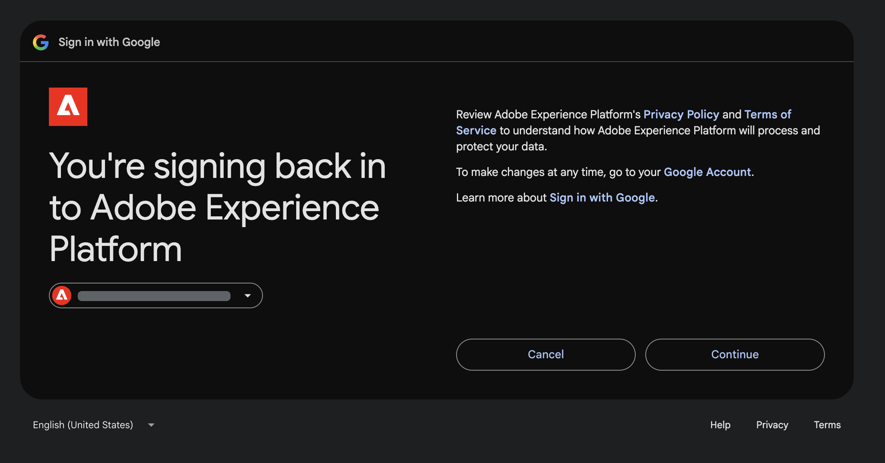
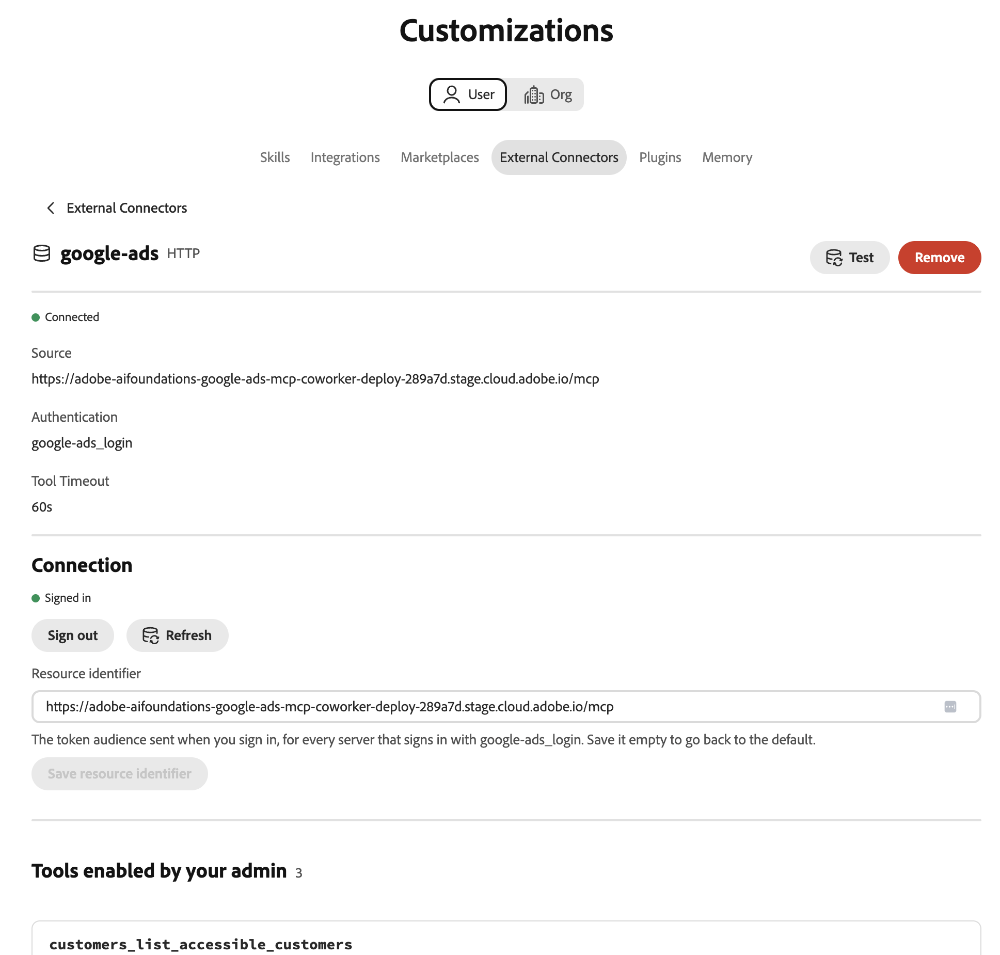

# Conector externo do Google Ads {#google-ads}

Use o conector externo do [!DNL Google Ads] para trabalhar com os dados do [!DNL Google Ads] no Adobe CX Enterprise Coworker. Depois de configurar o conector, pergunte ao Colaborador quais contas de anúncio você pode acessar, quais campos e métricas estão disponíveis e como suas campanhas se comportam. O conector é um servidor MCP (Model Context Protocol).

>[!AVAILABILITY]
>
>O conector externo [!DNL Google Ads] está na versão beta. A documentação e a funcionalidade estão sujeitas a alterações.

## Configuração do conector {#connector-configuration}

O processo de configuração do conector tem duas partes separadas:

* **Configuração da organização:** um administrador configura o conector para toda a organização e seleciona as ferramentas que os membros podem usar. A Adobe fornece o aplicativo OAuth, portanto, não há credenciais de aplicativo para inserir.
* **Entrada de membro:** cada membro entra com sua própria conta [!DNL Google]. Os membros podem acessar somente as contas do [!DNL Google Ads] que podem ser acessadas pela conta do [!DNL Google].

Salvar a configuração da organização não faz logon em nenhum membro nem concede acesso às contas do [!DNL Google Ads]. Cada membro deve fazer logon separadamente.

## Pré-requisitos {#prerequisites}

Antes de começar, verifique se você tem o seguinte:

* **Para configuração de organização:** uma conta com permissão para gerenciar conectores de organização no Colaborador.
* **Para entrada de membro:** Uma conta do [!DNL Google] com acesso às contas do [!DNL Google Ads] que você pretende usar.

## Configurar o conector do para sua organização {#configure-organization}

Os administradores disponibilizam o conector [!DNL Google Ads] para todos na organização. As alterações na página da organização se aplicam a todos os usuários da organização.

1. Abra **[!UICONTROL Personalizações]**, selecione **[!UICONTROL Org]** e **[!UICONTROL Conectores Externos]**. No cartão **[!UICONTROL Google Ads]**, selecione **[!UICONTROL Configurar]**.

1. Na caixa de diálogo **[!UICONTROL Configurar Google Ads para sua organização]**, confirme se o **[!UICONTROL aplicativo OAuth]** é o **[!UICONTROL aplicativo OAuth gerenciado pela Adobe]**. A Adobe fornece o aplicativo [!DNL Google Ads], portanto, você não precisa inserir credenciais de aplicativo. Em **[!UICONTROL Ferramentas disponíveis para usuários]**, selecione as ferramentas de que sua organização precisa. Para obter mais informações, consulte [Ferramentas disponíveis](#available-tools). Revise o aviso **[!UICONTROL Cada pessoa entra separadamente]** e selecione **[!UICONTROL Salvar conexão]**.

   {width="500" zoomable="yes"}

1. Revise os detalhes do conector **[!UICONTROL google-ads]** salvos.

   | Configuração | Descrição |
   | --- | --- |
   | **[!UICONTROL Source]** | O URL do servidor MCP do seu ambiente. |
   | **[!UICONTROL Authentication]** | O método de autenticação, `google-ads_login`. |
   | **[!UICONTROL Política de ferramenta]** | Os nomes ou padrões de ferramenta permitidos. |
   | **[!UICONTROL Conexão]** | Seu próprio status de logon. |

   {width="700" zoomable="yes"}

O status **[!UICONTROL Conexão]** nos detalhes do conector se refere à sua própria conexão, não à organização. Cada membro ainda precisa fazer logon com sua própria conta. Depois que os membros entrarem, eles poderão selecionar **[!UICONTROL Testar]** para testar a descoberta da ferramenta. Para usar o conector sozinho, siga as etapas em [Fazer logon como membro](#sign-in-as-a-member).

Para interromper a oferta do conector para sua organização, selecione **[!UICONTROL Remover]** na página de detalhes do conector.

### Ferramentas disponíveis {#available-tools}

O conector [!DNL Google Ads] fornece as seguintes ferramentas:

| Ferramenta | Descrição |
| --- | --- |
| `customers_list_accessible_customers` | Liste as IDs do cliente que sua conta do [!DNL Google] conectada pode acessar diretamente. |
| `metadata_get_resource_metadata` | Encontre os campos, métricas e segmentos que você pode usar para um recurso [!DNL Google Ads], como uma campanha ou grupo de anúncios. |
| `search_search` | Recuperar dados de configuração ou relatórios de [!DNL Google Ads]. |

## Fazer logon como membro {#sign-in-as-a-member}

Depois que um administrador configura o conector, cada membro entra com sua própria conta [!DNL Google].

1. Abra **[!UICONTROL Personalizações]**, selecione **[!UICONTROL Usuário]** e selecione **[!UICONTROL Conectores Externos]**. No cartão **[!UICONTROL Google Ads]**, selecione **[!UICONTROL Entrar]**.

   Se o cartão exibir **[!UICONTROL Não configurado]** ou se o conector não estiver disponível, peça ao administrador para [configurar o conector](#configure-organization).

1. Na tela [!DNL Google] **[!UICONTROL Escolher uma conta]**, selecione a conta com acesso às suas contas do [!DNL Google Ads] ou selecione **[!UICONTROL Usar outra conta]**. Em seguida, conclua todas as etapas de logon necessárias para sua organização, como logon único (SSO), autenticação multifator (MFA) ou verificação de identidade.

   As etapas e sua ordem dependem da organização e das políticas da conta.

   {width="500" zoomable="yes"}

1. Revise a conta selecionada e o aplicativo que você está autorizando e selecione **[!UICONTROL Continuar]**.

   [!DNL Google] mostra o nome do aplicativo como [!DNL Adobe Experience Platform]. Se você usou o aplicativo antes, [!DNL Google] mostra que você está entrando novamente. Usuários pela primeira vez podem ver prompts diferentes.

   {width="500" zoomable="yes"}

1. Revise a solicitação de acesso e selecione **[!UICONTROL Continuar]**.

   {width="500" zoomable="yes"}

   >[!IMPORTANT]
   >
   >Continue apenas se você reconhecer o aplicativo e sua organização aprovar o acesso solicitado.

1. Depois que [!DNL Google] retornar ao Colworker, abra os detalhes do conector **[!UICONTROL google-ads]**. Confirme se o conector mostra **[!UICONTROL Conectado]** e **[!UICONTROL Conectado]**.

   Mantenha o **[!UICONTROL Identificador de recursos]** com o valor padrão, a menos que o administrador informe o contrário. Este campo define o público-alvo do token enviado quando você entra. Para retornar ao padrão, desmarque o campo e selecione **[!UICONTROL Salvar identificador de recurso]**.

   {width="700" zoomable="yes"}

1. Selecione **[!UICONTROL Testar]** para verificar se o Colaborador pode descobrir as ferramentas do conector. Em seguida, confira as **[!UICONTROL Ferramentas habilitadas pelo administrador]** para exibir as ferramentas que você pode usar.

   **[!UICONTROL Teste]** está disponível depois que você entra.

   {width="700" zoomable="yes"}

Para desconectar sua conta do [!DNL Google] do conector, selecione **[!UICONTROL Sair]**. Os detalhes do conector também mostram a configuração **[!UICONTROL Tempo limite da ferramenta]** e um controle **[!UICONTROL Atualizar]**.

O status **[!UICONTROL Conectado]** não confirma o acesso a uma conta de anúncio específica ou que cada relatório é executado com êxito. Para confirmar seu acesso, [verifique seu acesso à conta de anúncio](#check-ad-account-access).

## Verifique o acesso à sua conta publicitária {#check-ad-account-access}

Para confirmar quais contas do [!DNL Google Ads] você pode usar, inicie um chat e insira um aviso.

Exemplo de prompt:

* &quot;Quais contas do Google Ads posso acessar?&quot;

O Colaborador usa a ferramenta `customers_list_accessible_customers` para listar as IDs de clientes que a conta do [!DNL Google] pode acessar diretamente. Esta é uma verificação de acesso à conta, não um relatório de desempenho. Se você usar uma conta de gerente, a lista não incluirá todas as contas sob ela.

Antes de solicitar um relatório, faça o seguinte:

* Escolha uma conta na lista.
* Especifique um intervalo de datas com uma data inicial e uma data final.
* Peça ao Colaborador para encontrar os campos e as métricas disponíveis para o relatório.

## Solução de problemas de acesso {#troubleshoot-access}

Se não conseguir acessar os dados do [!DNL Google Ads], verifique o seguinte com o administrador:

| Área | O que verificar |
| --- | --- |
| Conta [!DNL Google] | Você entrou com a conta [!DNL Google] que tem acesso à conta [!DNL Google Ads]. |
| Permissões da conta | Sua conta [!DNL Google] tem permissões para as contas [!DNL Google Ads] que você deseja usar. |
| Contas do gerente | Se você acessar uma conta por meio de uma conta de gerente, o administrador confirmará a configuração necessária da conta de gerente. |
| Seleção da ferramenta | O administrador habilitou as ferramentas necessárias em **[!UICONTROL Ferramentas disponíveis aos usuários]**. |
| Identificador do recurso | O **[!UICONTROL Identificador de recursos]** usa o valor padrão, a menos que o administrador tenha informado o contrário. |
