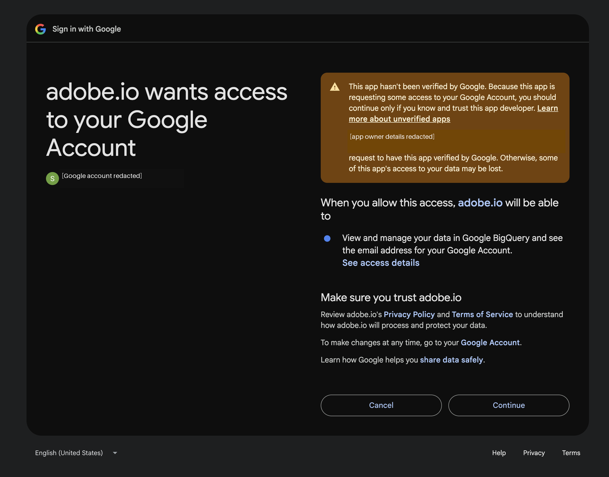

# Conector externo do Google BigQuery {#google-bigquery}

Use o conector externo [!DNL Google BigQuery] para explorar e consultar seus dados do [!DNL BigQuery] no Adobe CX Enterprise Coworker. Depois de configurar o conector, peça ao Colaborador para listar conjuntos de dados e tabelas, explicar um esquema de tabela e executar consultas SQL somente leitura. O conector é um servidor MCP hospedado por [!DNL Google] em `https://bigquery.googleapis.com/mcp`.

>[!AVAILABILITY]
>
>O conector externo [!DNL Google BigQuery] está na versão beta. A documentação e a funcionalidade estão sujeitas a alterações.

## Configuração do conector {#connector-configuration}

O processo de configuração do conector tem três partes separadas:

* **[!DNL Google Cloud]preparação:** Um administrador do [!DNL Google Cloud] prepara um projeto de consulta, habilita a API do [!DNL BigQuery] e concede aos membros as funções necessárias de Gerenciamento de Identidade e Acesso (IAM).
* **Configuração da organização:** um administrador de parceiro configura o conector uma vez para toda a organização. O administrador conecta o aplicativo OAuth [!DNL Google] da organização e seleciona as ferramentas que os membros podem usar.
* **Entrada de membro:** cada membro entra com sua própria conta [!DNL Google]. Os membros podem acessar somente os projetos e conjuntos de dados que sua identidade [!DNL Google] pode acessar.

O conector usa um aplicativo OAuth de propriedade da organização. A Adobe não fornece um aplicativo OAuth [!DNL Google] para esse conector. Salvar a configuração da organização não faz logon em nenhum membro nem concede permissões de [!DNL BigQuery]. Uma entrada bem-sucedida no [!DNL Google] também não concede acesso ao conjunto de dados, pois o IAM do [!DNL Google Cloud] controla o acesso aos seus dados.

## Pré-requisitos {#prerequisites}

Antes de começar, verifique se você tem o seguinte:

* **Para preparação de [!DNL Google Cloud]:** um administrador [!DNL Google Cloud] que pode habilitar APIs, conceder funções IAM e criar um cliente OAuth no [!DNL Google Auth Platform].
* **Para configuração de organização:** uma conta com permissão para gerenciar conectores de organização no Colaborador. Você também precisa da ID do cliente e do segredo do cliente de um cliente de aplicativo Web OAuth [!DNL Google] ou dos segredos da organização existentes que os contêm.
* **Para entrada de membro:** uma identidade [!DNL Google] que o público-alvo do aplicativo OAuth permite e que tem as funções IAM necessárias.

Saber a ID do projeto de consulta e os conjuntos de dados que os membros devem ler. O projeto de consulta executa trabalhos de consulta e os paga. Os dados podem viver em um projeto diferente, e o cliente OAuth também pode pertencer a um projeto separado. Para um piloto, um projeto pode conter o cliente OAuth, os trabalhos de consulta e os conjuntos de dados.

## Preparar [!DNL Google Cloud] {#prepare-google-cloud}

Antes de configurar o conector no Coworker, prepare seu projeto e o acesso do membro no [!DNL Google Cloud]. Criar o aplicativo OAuth e conceder acesso aos dados são tarefas separadas. Os membros que usam o conector não precisam de permissão para editar o aplicativo OAuth.

### Preparar o projeto de consulta {#prepare-query-project}

Um administrador [!DNL Google Cloud] prepara o projeto que executa os trabalhos de consulta:

1. No [Google Cloud Console](https://console.cloud.google.com/), selecione ou crie um projeto.
1. Habilite a API [!DNL BigQuery], se ela ainda não estiver habilitada. Habilitar a API também habilita o servidor MCP remoto [!DNL BigQuery].
1. Escolha a [sandbox do BigQuery](https://docs.cloud.google.com/bigquery/docs/sandbox) para cobrança e defina as [cotas de consulta personalizadas](https://docs.cloud.google.com/bigquery/docs/custom-quotas) diárias apropriadas no projeto de consulta.

>[!IMPORTANT]
>
>As consultas somente leitura ainda podem incorrer em encargos. Os custos de [!DNL BigQuery] dependem dos bytes examinados por uma consulta, não do número de linhas retornado. Uma cláusula `LIMIT` controla as linhas retornadas, mas geralmente não reduz os bytes verificados. Use execuções secas, colunas explícitas, filtros de partição e cotas de consulta diárias para controlar custos.

Para obter mais informações, consulte [Usar o servidor MCP remoto do BigQuery](https://docs.cloud.google.com/bigquery/docs/use-bigquery-mcp) na documentação [!DNL Google Cloud].

### Conceder funções IAM {#grant-iam-roles}

Conceda as seguintes funções às [!DNL Google] identidades de seus membros. Use um grupo gerenciado sempre que possível e prefira acesso a dados no nível do conjunto de dados.

| Função | Onde concedê-lo | Finalidade |
| --- | --- | --- |
| [!UICONTROL Usuário da Ferramenta MCP] (`roles/mcp.toolUser`) | Os projetos usados para chamadas MCP | Efetuar chamadas de ferramenta de MCP. |
| [!UICONTROL Usuário do Trabalho do BigQuery] (`roles/bigquery.jobUser`) | O projeto de consulta | Executar trabalhos de consulta. |
| [!UICONTROL Visualizador de Dados do BigQuery] (`roles/bigquery.dataViewer`) | Os conjuntos de dados ou projetos de dados autorizados | Leia dados e metadados. |

Não conceda ao [!UICONTROL BigQuery Data Editor], [!UICONTROL BigQuery Data Owner] ou [!UICONTROL BigQuery Admin] somente para usar este conector somente leitura. Como proteção adicional, considere uma [política de negação para ferramentas MCP de leitura-gravação](https://docs.cloud.google.com/mcp/prevent-read-write-tool-use). Peça ao administrador do [!DNL Google Cloud] para revisar primeiro o escopo da política de negação, pois ela pode afetar outros clientes e serviços de MCP do [!DNL Google]. Para obter mais informações, consulte [Funções e permissões de IAM do BigQuery](https://docs.cloud.google.com/bigquery/docs/access-control).

## Configurar o conector do para sua organização {#configure-organization}

Os administradores disponibilizam o conector [!DNL Google BigQuery] para todos na organização. As alterações na página da organização se aplicam a todos os usuários da organização.

1. Abra **[!UICONTROL Personalizações]**, selecione **[!UICONTROL Org]** e **[!UICONTROL Conectores Externos]**. No cartão **[!UICONTROL Google BigQuery]**, selecione **[!UICONTROL Configurar]**.

   Se o conector já estiver configurado, o cartão mostrará **[!UICONTROL Exibir configuração]**.

1. Na caixa de diálogo **[!UICONTROL Configurar Google BigQuery para sua organização]**, copie a **[!UICONTROL URL de Redirecionamento]** em **[!UICONTROL Seu aplicativo Google]**.

   O URL de redirecionamento difere entre ambientes e regiões, portanto, sempre copie o valor exato da caixa de diálogo. Não use a URL da página do Coworker no seu navegador ou a URL do servidor MCP [!DNL BigQuery]. Se um cliente OAuth atender a vários ambientes, registre cada URL de redirecionamento necessário separadamente.

1. Na [Plataforma de autenticação da Google](https://console.cloud.google.com/auth/overview), prepare o cliente OAuth da sua organização:

   1. Configurar a **[!UICONTROL Identidade Visual]** e o **[!UICONTROL Público]**. Para um aplicativo externo em teste, adicione os membros desejados como usuários de teste. Conclua os requisitos de publicação e verificação do [!DNL Google] antes de usar mais.
   1. Em **[!UICONTROL Acesso aos Dados]**, adicione o escopo `https://www.googleapis.com/auth/bigquery`.
   1. Em **[!UICONTROL Clientes]**, crie ou selecione um cliente OAuth com o tipo de aplicativo **[!UICONTROL Aplicativo Web]**.
   1. Adicione a URL de redirecionamento copiada para **[!UICONTROL URIs de redirecionamento autorizados]**.
   1. Obtenha a **[!UICONTROL ID do Cliente]** e o **[!UICONTROL segredo do Cliente]** por meio do processo de tratamento secreto aprovado pela sua organização.

   Os membros autorizam este aplicativo que pertence à sua organização, não um aplicativo fornecido pela Adobe. Mantenha o cliente em segredo sem capturas de tela, bate-papos e documentação.

1. Em **[!UICONTROL De onde vêm as credenciais]**, selecione uma das seguintes opções:

   * **[!UICONTROL Inserir novo]:** Insira a **[!UICONTROL ID do cliente Google OAuth]** e o **[!UICONTROL segredo do cliente Google OAuth]**. Colaborador armazena os valores informados como segredos da organização.
   * **[!UICONTROL Usar um segredo existente]:** Selecione os segredos da organização salvos que contêm a ID do cliente e o segredo do cliente.

   Não use segredos pessoais para um conector de organização.

   {width="500" zoomable="yes"}

1. Expanda o grupo de ferramentas **[!UICONTROL Explorar e consultar]**. Mantenha todas as sete ferramentas selecionadas ou selecione apenas as ferramentas de que seus membros precisam. Você deve selecionar pelo menos uma ferramenta. Para obter mais informações, consulte [Ferramentas disponíveis](#available-tools).

   Revise os avisos em **[!UICONTROL Acesso e permissões]**:

   * **[!UICONTROL Ferramentas somente leitura]:** O escopo OAuth é amplo e não impede alterações por conta própria. Mantenha as funções IAM de seus membros somente leitura.
   * **[!UICONTROL Consultas somente leitura podem gerar cobranças]:** Use execuções secas e cotas de consulta. Uma cláusula `LIMIT` controla as linhas retornadas, não necessariamente os bytes verificados.
   * **[!UICONTROL Cada pessoa entra separadamente]:** Cada membro precisa das funções IAM necessárias.

   Selecione **[!UICONTROL Salvar conexão]**. O cartão da organização mostra **[!UICONTROL Configuração salva]** e **[!UICONTROL Exibir configuração]**.

Salvar a configuração não faz logon nem de nenhum membro em [!DNL Google]. Salvar também não confirma se qualquer pessoa pode consultar um conjunto de dados. Para usar o conector sozinho, siga as etapas em [Fazer logon como membro](#sign-in-as-a-member).

### Ferramentas disponíveis {#available-tools}

O conector [!DNL Google BigQuery] fornece as seguintes ferramentas somente leitura:

| Ferramenta | Descrição |
| --- | --- |
| `list_dataset_ids` | Liste os conjuntos de dados em um projeto que você especificar. |
| `get_dataset_info` | Leia os metadados de um conjunto de dados. |
| `list_table_ids` | Listar as tabelas e as exibições em um conjunto de dados. |
| `get_table_info` | Leia o esquema e os metadados de uma tabela. |
| `execute_sql_readonly` | Execute consultas SQL somente leitura ou uma simulação para estimar os bytes que uma consulta verifica. |
| `get_query_results` | Recupere os resultados de uma consulta ou verifique uma consulta de longa execução. |
| `get_job` | Verifique o status, os erros e as estatísticas de um trabalho de consulta. |

Para fluxos de trabalho de consulta, mantenha `execute_sql_readonly`, `get_query_results` e `get_job` selecionados, para que o Colaborador possa seguir um trabalho de consulta de longa duração. O colega de trabalho não oferece as ferramentas `execute_sql` e `cancel_job` do servidor MCP [!DNL BigQuery]. As ferramentas que [!DNL Google] adicionar ao servidor posteriormente não serão habilitadas automaticamente. Para obter detalhes sobre a ferramenta, consulte a [referência do MCP do BigQuery](https://docs.cloud.google.com/bigquery/docs/reference/mcp).

Considere os seguintes limites ao usar as ferramentas:

* O [!DNL Google] documenta um limite de 3.000 linhas para resultados de consulta e um tempo limite de consulta padrão de três minutos. Não use o conector para exportar tabelas completas.
* As ferramentas não podem listar projetos. Forneça uma ID de projeto conhecida em sua solicitação.
* SQL somente leitura não dá suporte a instruções que alteram dados ou recursos, ou consultas em tabelas externas [!DNL Google Drive].
* Resultados da consulta, esquemas, listas de acesso ao conjunto de dados e SQL podem aparecer no chat. Certifique-se de que o Access siga a política de manuseio de dados da sua organização.

## Fazer logon como membro {#sign-in-as-a-member}

Depois que um administrador configura o conector, cada membro entra com sua própria conta [!DNL Google]. Você não precisa do segredo do cliente OAuth para entrar.

1. Abra **[!UICONTROL Personalizações]**, selecione **[!UICONTROL Usuário]** e selecione **[!UICONTROL Conectores Externos]**. No cartão **[!UICONTROL Google BigQuery]**, que mostra **[!UICONTROL Não conectado]**, selecione **[!UICONTROL Entrar]**.

   Se o cartão indicar que um administrador precisa configurar o conector, peça ao administrador para [configurar o conector](#configure-organization).

1. Na tela [!DNL Google] **[!UICONTROL Escolher uma conta]**, selecione a conta que tem o acesso IAM necessário ou selecione **[!UICONTROL Usar outra conta]**. Em seguida, conclua todas as etapas de logon necessárias para sua organização, como logon único (SSO) ou autenticação multifator (MFA).

   Essa conta pode ser diferente da conta usada para o Colaborador.

   {width="500" zoomable="yes"}

1. Se [!DNL Google] mostrar **[!UICONTROL a Google não verificou este aplicativo]**, confirme o aplicativo e seu proprietário com o administrador. Continue somente se a política da organização para aplicativos de teste permitir. Caso contrário, selecione **[!UICONTROL Voltar à segurança]** e peça ao proprietário do aplicativo para resolver os requisitos de público-alvo, publicação ou verificação.

   {width="500" zoomable="yes"}

   Revise o nome do aplicativo e o acesso solicitado na tela de consentimento. Em seguida, selecione **[!UICONTROL Continuar]** para concluir o fluxo de consentimento de [!DNL Google].

   [!DNL Google] solicita permissão para exibir e gerenciar seus dados do [!DNL BigQuery] e ver o endereço de email de sua conta do [!DNL Google]. Este é o escopo [!DNL BigQuery] padrão, mesmo que o Coworker ofereça apenas ferramentas somente leitura.

   Nas capturas de tela, o aplicativo é denominado adobe.io. O aplicativo de sua organização mostra seu próprio nome. Esse nome não significa que a Adobe fornece o aplicativo OAuth.

   >[!IMPORTANT]
   >
   >Continue apenas se você reconhecer o aplicativo e sua organização aprovar o acesso solicitado.

   {width="500" zoomable="yes"}

1. Retorne ao Colaborador e revise as **[!UICONTROL Ferramentas habilitadas pelo seu administrador]** nos detalhes do conector. Os membros podem exibir as ferramentas, mas não podem alterar a seleção da ferramenta. Para verificar a conexão, selecione **[!UICONTROL Testar]**.

   {width="700" zoomable="yes"}

Uma lista de ferramentas, um teste ou um logon bem-sucedido não confirma se você pode consultar um conjunto de dados específico. Para confirmar seu acesso, [verifique seu acesso ao BigQuery](#check-bigquery-access). Se o Colaborador informar que a conexão foi encerrada, entre novamente.

## Verifique seu acesso ao [!DNL BigQuery] {#check-bigquery-access}

Para confirmar que você pode ler seus dados, inicie um novo chat e insira um prompt somente leitura. Substitua os espaços reservados por projetos e tabelas que sua identidade [!DNL Google] possa acessar.

Exemplo de prompts:

* &quot;Listar os conjuntos de dados no projeto `YOUR_PROJECT_ID`.&quot;
* &quot;Usando `YOUR_QUERY_PROJECT_ID` para trabalhos de consulta, inspecione o esquema de `YOUR_DATA_PROJECT.YOUR_DATASET.YOUR_TABLE`, estime a verificação com uma execução seca e retorne um resumo agregado.&quot;

Confirme se os resultados incluem os conjuntos de dados ou os dados esperados. Prefira colunas explícitas, agregações e filtros de partição a solicitações de conteúdo de tabela bruta. Nomear um projeto em uma solicitação não altera sua identidade conectada nem concede acesso a esse projeto.

## Solução de problemas de acesso {#troubleshoot-access}

Se houver falha no logon ou no acesso, verifique o seguinte com o administrador:

| Problema | O que verificar |
| --- | --- |
| A placa informa que o conector não está configurado ou que um administrador precisa configurá-lo | A configuração da organização é salva para sua organização ativa. |
| `redirect_uri_mismatch` | A **[!UICONTROL URL de redirecionamento]** exata da caixa de diálogo Colaborador está registrada nos **[!UICONTROL URIs de redirecionamento autorizados]** no cliente do aplicativo Web. |
| `invalid_client` | A ID do cliente e o segredo do cliente pertencem ao cliente da aplicação web e os segredos da organização selecionados estão corretos. |
| `access_denied` ou um aviso de que [!DNL Google] não verificou o aplicativo | O proprietário do aplicativo verifica o público-alvo, a qualificação do usuário de teste e o status de verificação. Não aprove um aplicativo que você não reconhece. |
| A conexão foi encerrada ou o token expirou | Faça logon novamente como membro. |
| Permissão negada para `mcp.tools.call` | A função de [!UICONTROL Usuário da Ferramenta MCP] e qualquer política de negação IAM aplicável. |
| Permissão negada para `bigquery.jobs.create` | A função de [!UICONTROL Usuário do Trabalho do BigQuery] no projeto de consulta. |
| Acesso negado a uma tabela | A função [!UICONTROL Visualizador de Dados do BigQuery] no conjunto de dados e a conta [!DNL Google] com a qual você entrou. |
| `SERVICE_DISABLED` | A API [!DNL BigQuery] está habilitada no projeto que o erro identifica. |
| A cota de consulta diária foi excedida | A cota de consulta do projeto, com o administrador do projeto. |
| Falha em uma solicitação para inserir, atualizar, excluir, criar ou eliminar dados | O conector é somente leitura e não oferece suporte a alterações nos dados ou recursos. |

Ao entrar em contato com o suporte, não compartilhe segredos do cliente, tokens de acesso, códigos de autorização ou dados do cliente.
