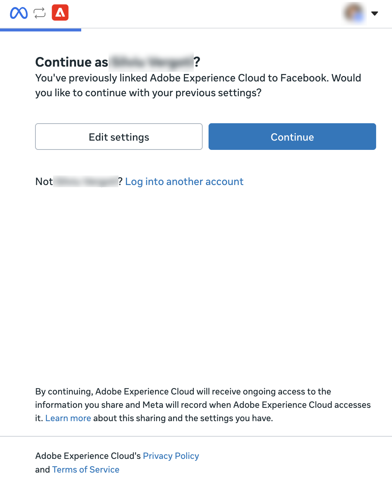

# Conector externo do Meta Ads {#meta-ads}

Use o conector externo do [!DNL Meta Ads] para trabalhar com seus dados de publicidade do [!DNL Meta] no Adobe CX Enterprise Coworker. Depois de configurar o conector, peça ao Colaborador para relatar o desempenho do anúncio, gerenciar campanhas e públicos, trabalhar com catálogos de produtos e muito mais. O conector é um servidor MCP hospedado por [!DNL Meta].

>[!AVAILABILITY]
>
>O conector externo [!DNL Meta Ads] está na versão beta. A documentação e a funcionalidade estão sujeitas a alterações.

## Configuração do conector {#connector-configuration}

O processo de configuração do conector tem duas partes separadas:

* **Configuração da organização:** um administrador configura o conector uma vez para toda a organização. O administrador escolhe o aplicativo OAuth e seleciona as ferramentas que os membros podem usar.
* **Entrada de membro:** cada membro entra com sua própria conta [!DNL Facebook]. Os membros podem acessar somente os ativos do [!DNL Meta] que sua identidade do [!DNL Facebook] e o aplicativo autorizado permitem.

Salvar a configuração da organização não faz logon em nenhum membro nem concede acesso a contas de anúncios. Cada membro deve fazer logon separadamente.

## Pré-requisitos {#prerequisites}

Antes de começar, verifique se você tem o seguinte:

* **Para configuração de organização:** uma conta com permissão para gerenciar conectores de organização no Colaborador.
* **Para entrada de membro:** Uma conta do [!DNL Facebook] com acesso a contas de anúncios, negócios, Páginas ou outros ativos do [!DNL Meta] que você planeja usar.
* **Para seu próprio aplicativo OAuth (opcional):** Um aplicativo [!DNL Meta] gerenciado pela organização, junto com a ID do aplicativo e o segredo do aplicativo.

## Configurar o conector do para sua organização {#configure-organization}

Os administradores disponibilizam o conector [!DNL Meta Ads] para todos na organização. As alterações na página da organização se aplicam a todos os usuários da organização.

1. Abra **[!UICONTROL Personalizações]**, selecione **[!UICONTROL Org]** e **[!UICONTROL Conectores Externos]**. No cartão **[!UICONTROL Meta Ads]**, selecione **[!UICONTROL Configurar]**.

1. Na caixa de diálogo **[!UICONTROL Configurar Meta Ads para sua organização]**, verifique os **[!UICONTROL detalhes da conexão]** e selecione um **[!UICONTROL aplicativo OAuth]**:

   * **[!UICONTROL Aplicativo OAuth gerenciado pela Adobe]:** O Adobe fornece o aplicativo [!DNL Meta Ads], portanto, não é necessário inserir credenciais de aplicativo. Cada membro ainda se conecta com sua própria conta [!DNL Facebook] depois que você salvar.

     {width="500" zoomable="yes"}

   * **[!UICONTROL Usar meu próprio aplicativo OAuth]:** Sua organização fornece seu próprio aplicativo [!DNL Meta]. Os membros autorizam seu aplicativo, não o aplicativo Adobe. Em **[!UICONTROL Seu aplicativo do Meta]**, conclua as seguintes etapas:

     1. Copie a **[!UICONTROL URL de redirecionamento]** e adicione-a às configurações de logon do aplicativo [!DNL Meta]. Use o valor exato mostrado na caixa de diálogo, pois o URL de redirecionamento é diferente entre os ambientes.
     1. Em **[!UICONTROL De onde vêm as credenciais]**, selecione **[!UICONTROL Inserir novo]** e insira a **[!UICONTROL ID do aplicativo Meta]** e o **[!UICONTROL segredo do aplicativo Meta]**. Encontre a ID do aplicativo nas configurações básicas do seu aplicativo [!DNL Meta]. O Colaborador armazena o segredo do aplicativo como um segredo da organização. Para reutilizar as credenciais salvas para o mesmo aplicativo, selecione **[!UICONTROL Usar um segredo existente]**.
     1. Disponibilize o aplicativo para os membros que farão logon. Peça ao administrador do aplicativo [!DNL Meta] para confirmar as permissões necessárias e os requisitos de revisão do aplicativo para o uso pretendido.

     O indicador **[!UICONTROL Discovered from the MCP server]** confirma que o Coworker encontrou o conector. Não confirma se suas credenciais do aplicativo são válidas ou se os membros entraram. Para atualizar a descoberta, selecione **[!UICONTROL Descobrir novamente]**.

     {width="500" zoomable="yes"}

1. Em **[!UICONTROL Ferramentas disponíveis para usuários]**, expanda cada grupo de ferramentas e selecione as ferramentas de que sua organização precisa. Para alterar todas as ferramentas de uma só vez, use **[!UICONTROL Selecionar tudo]** ou **[!UICONTROL Limpar tudo]**. Para obter mais informações, consulte [Grupos de ferramentas](#tool-groups). Em seguida, selecione **[!UICONTROL Salvar conexão]**.

   {width="500" zoomable="yes"}

1. Revise os detalhes do conector salvo **[!UICONTROL meta-ads]**. Opcionalmente, selecione **[!UICONTROL Testar]** para verificar se o Colaborador pode descobrir as ferramentas do conector.

   | Configuração | Descrição |
   | --- | --- |
   | **[!UICONTROL Source]** | O servidor MCP [!DNL Meta Ads], `https://mcp.facebook.com/ads`. |
   | **[!UICONTROL Authentication]** | O método de autenticação, `meta-ads_login`. |
   | **[!UICONTROL Conexão]** | O aplicativo OAuth em uso e seu próprio status de logon. |
   | **[!UICONTROL Ferramentas]** | As ferramentas selecionadas para membros, com controles **[!UICONTROL Selecionar tudo]** e **[!UICONTROL Limpar]** e uma contagem de ferramentas selecionadas. |

   {width="700" zoomable="yes"}

O status **[!UICONTROL Não conectado]** nos detalhes do conector se refere à sua própria conexão, não à organização. Para usar o conector por conta própria, selecione **[!UICONTROL Entrar]** e siga as etapas em [Entrar como membro](#sign-in-as-a-member).

Para interromper a oferta do conector para sua organização, selecione **[!UICONTROL Remover]** na página de detalhes do conector.

### Grupos de ferramentas {#tool-groups}

O conector [!DNL Meta Ads] organiza suas ferramentas nos seguintes grupos:

* [!UICONTROL Relatórios e insights]
* [!UICONTROL Anúncios, campanhas e públicos]
* [!UICONTROL Catálogos e produtos]
* [!UICONTROL Sinais e conjuntos de dados]
* [!UICONTROL Testes A/B e estudos de aumento]
* [!UICONTROL Logs de atividades]
* [!UICONTROL Ajuda e solução de problemas]

Por exemplo, o grupo [!UICONTROL Relatórios e insights] inclui ferramentas como `ads_insights_performance_trend` e `ads_insights_industry_benchmark`. As ferramentas em cada grupo podem ser alteradas à medida que [!DNL Meta] atualiza o conector.

>[!IMPORTANT]
>
>Nem todas as ferramentas são somente leitura. Algumas ferramentas podem alterar campanhas, orçamentos, públicos, catálogos ou outros ativos de publicidade. Selecione apenas as ferramentas que sua organização pretende que os membros usem.

Após salvar, as ferramentas que você deixar desmarcadas não estarão disponíveis para os membros até que você as selecione. Para confirmar quais ferramentas os membros podem usar, revise a seção **[!UICONTROL Ferramentas disponíveis]** na página de detalhes do conector.

## Fazer logon como membro {#sign-in-as-a-member}

Depois que um administrador configura o conector, cada membro entra com sua própria conta [!DNL Facebook]. Você não precisa de um segredo do aplicativo ou token de acesso para entrar.

1. Abra **[!UICONTROL Personalizações]**, selecione **[!UICONTROL Usuário]** e selecione **[!UICONTROL Conectores Externos]**.

1. No cartão **[!UICONTROL Meta Ads]**, selecione **[!UICONTROL Entrar]**.

   Se o cartão exibir **[!UICONTROL Não configurado]** ou se o conector não estiver disponível, peça ao administrador para [configurar o conector](#configure-organization).

1. Entre no [!DNL Facebook] e conclua todos os prompts necessários, como logon único (SSO), autenticação multifator (MFA), consentimento ou verificação de identidade.

   A ordem desses prompts depende da sua conta e das políticas da organização. Os usuários pela primeira vez também podem ver solicitações para conceder permissões e selecionar ativos.

1. Revise a conta [!DNL Facebook] e o aplicativo que você está autorizando e siga um destes procedimentos:

   * Para manter suas configurações anteriores, selecione **[!UICONTROL Continuar]**.
   * Para revisar ou alterar a autorização, selecione **[!UICONTROL Editar configurações]**.
   * Para usar uma conta [!DNL Facebook] diferente, selecione **[!UICONTROL Fazer logon em outra conta]**.

   Com o aplicativo gerenciado pela Adobe, você autoriza [!DNL Adobe Experience Cloud]. Com o aplicativo da sua própria organização, o nome do aplicativo e os prompts são diferentes.

   {width="400" zoomable="yes"}

   >[!IMPORTANT]
   >
   >O aplicativo recebe acesso contínuo às informações que você compartilha e [!DNL Meta] registros quando o aplicativo acessa essas informações. Continue somente se sua organização aprovar o acesso solicitado.

1. Depois que [!DNL Facebook] retornar ao Colworker, abra os detalhes do conector de **[!UICONTROL metaanúncios]**. Confirme se o conector mostra **[!UICONTROL Conectado]** e **[!UICONTROL Conectado]**.

   {width="700" zoomable="yes"}

1. Revise as **[!UICONTROL Ferramentas habilitadas pelo administrador]** para exibir as ferramentas que você pode usar.

Os detalhes do conector também mostram a configuração **[!UICONTROL Tempo limite da ferramenta]** e os seguintes controles:

* **[!UICONTROL Recarregar ferramentas]:** Atualize a lista de ferramentas.
* **[!UICONTROL Teste]:** verifique se o Colaborador pode descobrir as ferramentas do conector.
* **[!UICONTROL Sair]:** Desconecte sua conta do [!DNL Facebook] do conector.

O status **[!UICONTROL Conectado]** não confirma o acesso a uma conta de anúncio específica ou que todas as ferramentas são executadas com êxito. Para confirmar seu acesso, [verifique seu acesso à conta de anúncio](#check-ad-account-access).

## Verifique o acesso à sua conta publicitária {#check-ad-account-access}

Para confirmar quais contas de anúncio você pode usar, inicie um chat e insira um prompt somente leitura.

Exemplo de prompt:

* &quot;Quais contas de anúncios do Meta posso acessar? Liste-as sem mudar nada.&quot;

Se o administrador tiver habilitado a ferramenta `ads_get_ad_accounts`, o Co-worker listará as contas de anúncios que você poderá acessar. Para cada conta, o Colaborador mostra o negócio proprietário, a qualificação para MCP e a disponibilidade de relatórios. Escolha uma conta acessível antes de solicitar relatórios ou realizar ações.

## Solução de problemas de acesso {#troubleshoot-access}

Se não conseguir acessar os ativos do [!DNL Meta], verifique o seguinte:

| Área | O que verificar |
| --- | --- |
| Conta [!DNL Facebook] | Você entrou com a conta [!DNL Facebook] que tem acesso à conta de anúncio. |
| Permissões de ativos | Sua conta do [!DNL Facebook] tem permissões para as contas de anúncios, empresas ou Páginas que você deseja usar. |
| Autorização do aplicativo | Você autorizou o aplicativo e compartilhou os ativos necessários. Para revisar a autorização, saia e entre novamente e selecione **[!UICONTROL Editar configurações]**. |
| Ferramentas habilitadas | O administrador habilitou as ferramentas necessárias em **[!UICONTROL Ferramentas disponíveis aos usuários]**. |
| Seu próprio aplicativo OAuth | O URL de redirecionamento corresponde exatamente, a ID do aplicativo e o segredo do aplicativo estão corretos e os membros têm acesso ao aplicativo. Confirme as permissões necessárias com o administrador do aplicativo [!DNL Meta]. |
