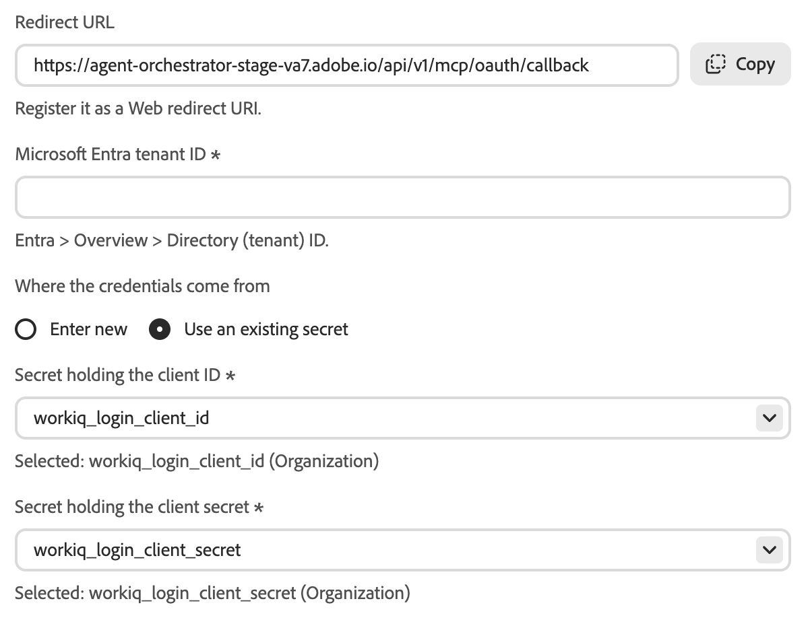
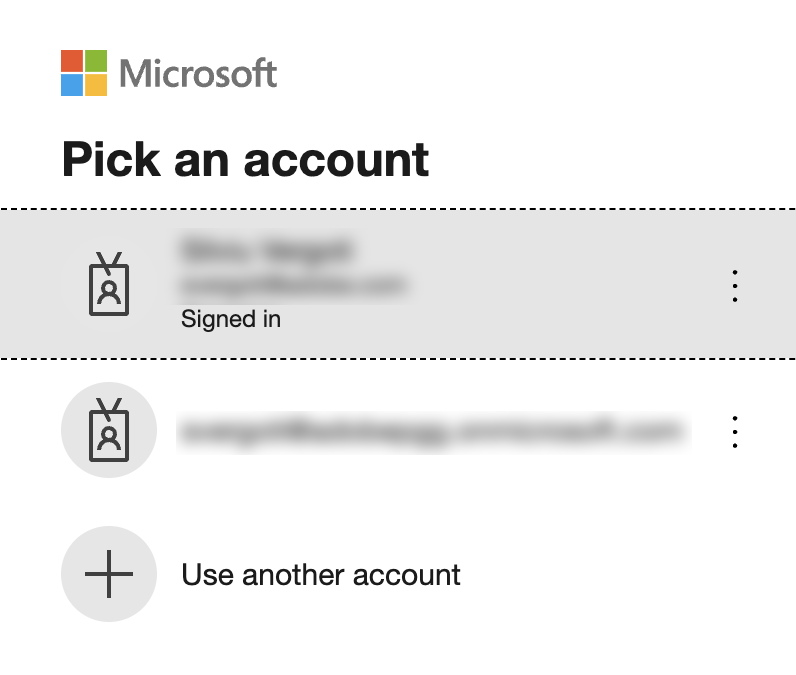

# Conector externo do Microsoft Work IQ {#microsoft-work-iq}

Use o conector externo do [!DNL Microsoft Work IQ] para trabalhar com os dados do [!DNL Microsoft 365] no Adobe CX Enterprise Coworker. Depois de configurar o conector, peça ao Coworker para pesquisar seus emails, arquivos, reuniões e [!DNL Microsoft Teams] mensagens, revisar eventos de calendário e muito mais. O conector é um servidor MCP hospedado por [!DNL Microsoft].

>[!AVAILABILITY]
>
>O conector externo [!DNL Microsoft Work IQ] está na versão beta. A documentação e a funcionalidade estão sujeitas a alterações.

## Configuração do conector {#connector-configuration}

O processo de configuração do conector tem duas partes separadas:

* **Configuração da organização:** um administrador configura o conector uma vez para toda a organização. O administrador conecta um aplicativo [!DNL Microsoft Entra] e seleciona as ferramentas que os membros podem usar.
* **Entrada de membro:** cada membro entra com sua própria conta comercial [!DNL Microsoft]. Os membros podem acessar somente os dados que sua conta pode acessar.

Salvar a configuração da organização não faz logon em nenhum membro nem concede permissões [!DNL Microsoft 365] adicionais. Cada membro deve fazer logon separadamente.

O cartão **[!UICONTROL Microsoft Work IQ]** menciona um aplicativo OAuth compartilhado, que está disponível apenas quando a implantação configura um. Não presuma que um aplicativo já foi fornecido. Esta página descreve como conectar seu próprio aplicativo [!DNL Microsoft Entra].

## Pré-requisitos {#prerequisites}

Antes de começar, verifique se você tem o seguinte:

* **Para configuração de organização:** uma conta com permissão para gerenciar conectores de organização no Colaborador.
* **Para o aplicativo [!DNL Microsoft Entra]:** um administrador [!DNL Microsoft Entra] que pode registrar um aplicativo Web e dar consentimento administrativo.
* **Para o locatário [!DNL Microsoft]:** [!DNL Work IQ] habilitado para o locatário.
* **Para entrada de membro:** uma conta de trabalho [!DNL Microsoft] qualificada com acesso aos dados que você planeja usar.

## Configurar o conector do para sua organização {#configure-organization}

Os administradores disponibilizam o conector [!DNL Microsoft Work IQ] para todos na organização. As alterações na página da organização se aplicam a todos os usuários da organização.

1. Abra **[!UICONTROL Personalizações]**, selecione **[!UICONTROL Org]** e **[!UICONTROL Conectores Externos]**. No cartão **[!UICONTROL Microsoft Work IQ]**, selecione **[!UICONTROL Configurar]**.

1. Na caixa de diálogo **[!UICONTROL Configurar Microsoft Work IQ para sua organização]**, verifique a **[!UICONTROL URL do Servidor]**, `https://workiq.svc.cloud.microsoft/mcp`. Em seguida, prepare seu aplicativo [!DNL Microsoft Entra]. Para os requisitos de [!DNL Microsoft], selecione **[!UICONTROL instruções de instalação do Microsoft]** na caixa de diálogo.

   1. Registre um aplicativo Web em [!DNL Microsoft Entra] ou use um existente.
   1. Copie a **[!UICONTROL URL de redirecionamento]** da caixa de diálogo e registre esse valor exato como um URI de redirecionamento da Web no aplicativo. O URL de redirecionamento difere entre os ambientes, portanto, sempre o copie da caixa de diálogo.
   1. Crie um segredo de cliente ou confirme se o segredo de cliente existente ainda é válido. Você precisa do valor secreto, não da ID secreta.
   1. Conceda consentimento administrativo para a permissão `WorkIQAgent.Ask` delegada e confirme se [!DNL Work IQ] está habilitado para seu locatário.

   Em **[!UICONTROL ID de locatário do Microsoft Entra]**, insira sua ID de locatário. Em [!DNL Microsoft Entra], encontre este valor em **[!UICONTROL Visão geral]** > **[!UICONTROL ID do Diretório (locatário)]**.

   {width="500" zoomable="yes"}

1. Em **[!UICONTROL De onde vêm as credenciais]**, selecione uma das seguintes opções:

   * **[!UICONTROL Inserir novo]:** Em **[!UICONTROL ID de cliente do aplicativo OAuth]**, insira a ID de aplicativo (cliente) do seu aplicativo [!DNL Microsoft Entra]. Em **[!UICONTROL segredo do cliente do aplicativo OAuth]**, insira o valor do segredo. O colaborador armazena o valor do segredo como um segredo da organização.
   * **[!UICONTROL Usar um segredo existente]:** Em **[!UICONTROL Segredo que contém a ID de cliente]** e **[!UICONTROL Segredo que contém o segredo do cliente]**, selecione os segredos da organização salvos para o seu aplicativo. Se os segredos corretos não estiverem disponíveis, selecione **[!UICONTROL Inserir novo]**. Ainda é possível inserir a ID do locatário separadamente.

   A ID do locatário, a ID do cliente e o segredo do cliente devem pertencer ao mesmo aplicativo e locatário. Se você reutilizar os segredos salvos, confirme se o segredo do cliente não expirou. Essas credenciais de aplicativo são separadas das [!DNL Microsoft] senhas que os membros usam para entrar.

   {width="500" zoomable="yes"}

1. Em **[!UICONTROL Ferramentas disponíveis para usuários]**, selecione as ferramentas de que sua organização precisa. Para obter mais informações, consulte [Ferramentas disponíveis](#available-tools). Revise **[!UICONTROL Acesso e permissões]**, que confirma que cada pessoa entra separadamente e selecione **[!UICONTROL Salvar configuração]**.

   {zoomable="yes"}

1. Revise os detalhes do conector do **[!UICONTROL workiq]** salvo. Opcionalmente, selecione **[!UICONTROL Testar]** para verificar se o Colaborador pode descobrir as ferramentas do conector. Para alterar as ferramentas depois de salvar, consulte [Alterar a seleção da ferramenta](#change-tool-selection).

   | Configuração | Descrição |
   | --- | --- |
   | **[!UICONTROL Source]** | O servidor MCP [!DNL Work IQ], `https://workiq.svc.cloud.microsoft/mcp`. |
   | **[!UICONTROL Authentication]** | O método de autenticação, `workiq_login`. |
   | **[!UICONTROL Tempo limite da ferramenta]** | O tempo limite da ferramenta para o conector. |
   | **[!UICONTROL Conexão]** | Seu próprio status de logon. |

   {width="500" zoomable="yes"}

O status **[!UICONTROL Não conectado]** nos detalhes do conector se refere à sua própria conexão, não à organização. Para usar o conector por conta própria, selecione **[!UICONTROL Entrar]** e siga as etapas em [Entrar como membro](#sign-in-as-a-member).

Para interromper a oferta do conector para sua organização, selecione **[!UICONTROL Remover]** na página de detalhes do conector.

### Ferramentas disponíveis {#available-tools}

O conector [!DNL Microsoft Work IQ] fornece as seguintes ferramentas:

| Ferramenta | Descrição |
| --- | --- |
| `search_paths` | Descubra quais recursos do [!DNL Microsoft 365] estão disponíveis e como resolvê-los. |
| `get_schema` | Veja quais campos uma solicitação compatível aceita ou retorna. |
| `list_agents` | Veja os [!DNL Microsoft 365 Copilot] agentes disponíveis para sua conta, sem executá-los. |
| `fetch` | Leia [!DNL Microsoft 365] itens que sua conta pode acessar, como mensagens, eventos, arquivos e pessoas. Não altera dados. |
| `call_function` | Calcular resultados dos dados que sua conta pode acessar, como uma exibição de calendário ou alterações recentes. Não altera dados. |
| `retrieve` | Pesquise emails, arquivos, reuniões, [!DNL Microsoft Teams] mensagens, pessoas e fontes conectadas, com links para cada fonte. |
| `fetch_blob` | Baixe um arquivo, como um documento, uma imagem ou uma foto de perfil, até 4 MB. Não altera dados. |
| `ask` | Pergunte a [!DNL Microsoft 365 Copilot] ou um de seus agentes sobre email, reuniões, arquivos e outros dados do [!DNL Microsoft 365]. |
| `delete_entity` | Excluir um item [!DNL Microsoft 365], como uma mensagem ou um evento. Altera os dados. |
| `do_action` | Executar uma ação de [!DNL Microsoft 365], como enviar email ou mover um item. Altera os dados. |
| `create_entity` | Criar um item [!DNL Microsoft 365], como um evento ou rascunho de mensagem. Altera os dados. |
| `update_entity` | Alterar um item [!DNL Microsoft 365] existente, como um evento ou um contato. Altera os dados. |

>[!IMPORTANT]
>
>As ferramentas `delete_entity`, `do_action`, `create_entity` e `update_entity` alteram dados em [!DNL Microsoft 365]. Revise essas ferramentas cuidadosamente e selecione apenas as ferramentas que sua organização pretende que os membros usem.

As ferramentas que o servidor adicionar posteriormente permanecerão desativadas até que você as selecione.

### Alterar a seleção da ferramenta {#change-tool-selection}

Para alterar as ferramentas disponíveis para membros após salvar, use a seção **[!UICONTROL Ferramentas]** na página de detalhes do conector.

1. Selecione ou limpe ferramentas individuais, ou use **[!UICONTROL Selecionar tudo]** ou **[!UICONTROL Limpar]**.

1. Selecione **[!UICONTROL Salvar seleção de ferramenta]**.

>[!CAUTION]
>
>Selecionar **[!UICONTROL Mostrar todas as ferramentas]** limpa a seleção atual. Os membros poderão usar todas as ferramentas que a política não excluir até que você salve uma nova seleção. Não selecione **[!UICONTROL Mostrar todas as ferramentas]** somente para exibir a lista de ferramentas.

## Fazer logon como membro {#sign-in-as-a-member}

Depois que um administrador configura o conector, cada membro entra com sua própria conta de trabalho [!DNL Microsoft]. Você não precisa do app client secret para entrar.

1. Abra **[!UICONTROL Personalizações]**, selecione **[!UICONTROL Usuário]** e selecione **[!UICONTROL Conectores Externos]**.

1. No cartão **[!UICONTROL Microsoft Work IQ]**, selecione **[!UICONTROL Entrar]**.

   Se o cartão exibir **[!UICONTROL Não configurado]** ou se o conector não estiver disponível, peça ao administrador para [configurar o conector](#configure-organization).

1. Na tela [!DNL Microsoft] **[!UICONTROL Escolha uma conta]**, selecione a conta corporativa da sua organização ou selecione **[!UICONTROL Usar outra conta]**.

   Seu navegador pode lembrar de várias contas, incluindo contas de outros locatários. A conta que já entrou nem sempre é a correta. Escolha a conta com o acesso [!DNL Microsoft 365] necessário.

   {width="400" zoomable="yes"}

1. Conclua as etapas de logon da sua conta, como senha, logon único (SSO), logon sem senha, autenticação multifator (MFA) ou outra verificação.

   Insira suas credenciais do [!DNL Microsoft] somente no fluxo de entrada que sua organização aprova. Nunca os insira nos campos de aplicativo OAuth do conector.

   {width="400" zoomable="yes"}

1. Se [!DNL Microsoft] solicitar consentimento, reveja a solicitação.

   >[!IMPORTANT]
   >
   >Continue apenas se você reconhecer o aplicativo e sua organização aprovar o acesso solicitado.

1. Depois que [!DNL Microsoft] retornar ao Colaborador, abra os detalhes do conector **[!UICONTROL workiq]**. Confirme se o conector mostra **[!UICONTROL Conectado]** e **[!UICONTROL Conectado]**.

   {width="700" zoomable="yes"}

1. Revise as **[!UICONTROL Ferramentas habilitadas pelo administrador]** para exibir as ferramentas que você pode usar.

Nos detalhes do conector, você também pode fazer o seguinte:

* **[!UICONTROL Teste]:** verifique se o Colaborador pode descobrir as ferramentas do conector.
* **[!UICONTROL Sair]:** Desconecte sua conta do [!DNL Microsoft] do conector.

Os detalhes do conector também mostram a configuração **[!UICONTROL Tempo limite da ferramenta]** e um controle **[!UICONTROL Atualizar]**.

O status **[!UICONTROL Conectado]** não confirma que você pode acessar todos os recursos [!DNL Microsoft 365] ou que todas as ferramentas são executadas com êxito. Para confirmar seu acesso, [verifique seu acesso ao Microsoft 365](#check-access).

## Verifique o acesso ao Microsoft 365 {#check-access}

Para confirmar se o conector pode ler seus dados, inicie um chat e insira um prompt somente leitura.

Exemplo de prompt:

* &quot;Encontre minhas reuniões para amanhã e inclua links para as fontes. Não crie, atualize, envie ou exclua nada.&quot;

Para que esse aviso funcione, o administrador deve habilitar uma ferramenta que possa ler dados de calendário, e sua conta deve ter acesso aos dados.

## Solução de problemas de acesso {#troubleshoot-access}

Se houver falha no logon ou no acesso, verifique o seguinte com o administrador:

| Área | O que verificar |
| --- | --- |
| Conta [!DNL Microsoft] | Você entrou com a conta de trabalho correta para o locatário pretendido. |
| [!DNL Work IQ] disponibilidade | [!DNL Work IQ] está habilitado para seu locatário [!DNL Microsoft]. |
| URI de redirecionamento | O aplicativo [!DNL Microsoft Entra] tem a URL de redirecionamento exata da caixa de diálogo registrada como URI de redirecionamento da Web. |
| Consentimento do administrador | Um administrador concedeu consentimento administrativo para a permissão delegada `WorkIQAgent.Ask`. |
| Segredo do cliente | O segredo do cliente não expirou e o conector usa o valor do segredo, não a ID do segredo. |
| Segredos salvos | Ambos os segredos da organização selecionados pertencem ao aplicativo [!DNL Microsoft Entra] pretendido. |
| Seleção da ferramenta | Se apenas uma ferramenta falhar, o administrador ativou essa ferramenta. |
| [!DNL Microsoft 365] permissões | Sua conta tem permissão para acessar os dados solicitados. |
